
<a class="back" href="{{ '/documents/pywidget/app-guide/' | relative_url }}">← App Guide</a><a href="{{ '/documents/pywidget/app-guide-02-screens.html' | relative_url }}" rel="bookmark">Permanent link</a>

GuideDay 9 · Fri Oct 30<code>pywidget/app-guide-02-screens.md</code>
<h1>App guide, part 2: A tour of every screen, in the order a new person meets it</h1>
By <a href="{{ '/cast/maren.html' | relative_url }}">Maren</a>, Product and visual designer


Part 2 of 10 of the pywidget app guide. The index, with the reading notes, is [app-guide.md](app-guide.html).

Decision records are named by number, for example ADR-001. The list is in section 4.

## 2.1 First-run tour: not built yet

A short tour is planned for the first launch, with a third page that lets you pick a date and watch a countdown widget redraw. Nothing exists yet. It comes after the gallery (T-0191); both are planned for Days 16 to 20 (2026-11-06 to 2026-11-10), and the freeze is Day 21. Task T-0193.

## 2.2 The Console: where you write and run

This is the screen the app opens on today. Your script (the text of your program, shown in a monospaced typeface) sits in the code editor at the top, coloured and with line numbers (section 2.3). At the bottom is the console, a strip of text where the script's output appears. When the app opens, the console says "Python 3.15.1 ready" and how long that took (about 0.2 seconds). Three buttons sit at the top right: Run, a bin that clears the console, and a "more" button (three dots in a circle). While a script runs, Run turns into Stop. The script in this picture asks for a name and then greets you.

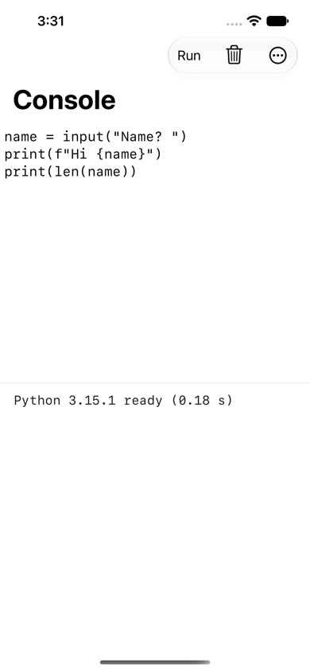 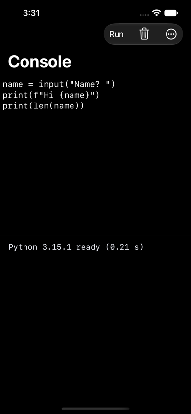

What you can do: type or paste a script, press Run, and read the output. What happens behind it: the app starts Python inside itself, runs your text, and shows everything the script prints in the console as it happens. No server is involved.

After Run, the console shows what the script printed and a line saying how long it took ("Finished in ..."):

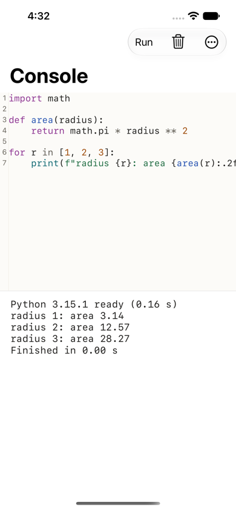 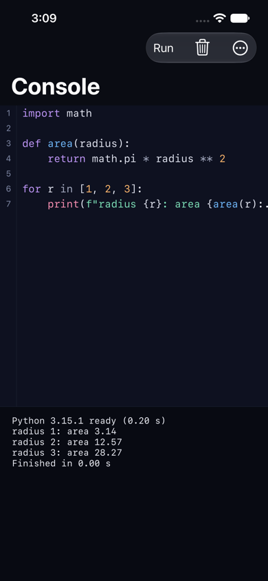

A script can ask you a question (Python's command for this is `input()`). The console then shows a rounded answer box labelled "input()" with a send arrow, the keyboard rises, and the script waits for your answer. The button at the top now says Stop:

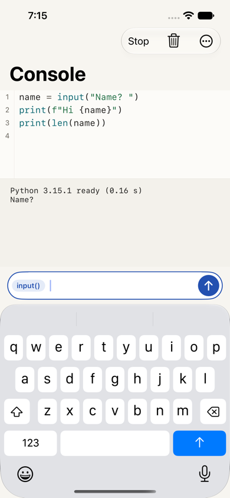 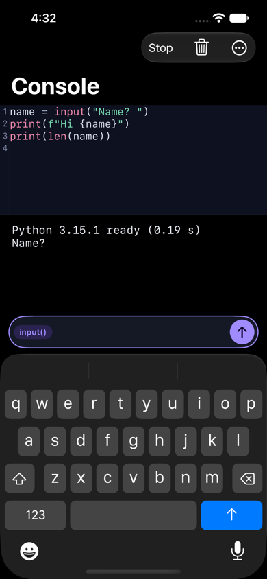

Behind it: the script is paused, not stopped, until you reply. Stop ends the run at any time.

## 2.3 The editor

Since 28 October 2026 (task T-0565, commit 5ac90a05) the box you type in on the Console screen is the real code editor. It colours the script by meaning (reserved words, text in quotes, numbers), numbers the lines, and adds a row of extra keys above the keyboard on iPhone for characters that are hard to reach (tab, brackets, colon, equals, quote mark, undo, and a button to hide the keyboard). With a hardware keyboard attached, the extra row stays hidden. The first picture is the Console screen itself; the other two come from a separate test screen that holds the same editor. The pictures were taken by an automatic test:

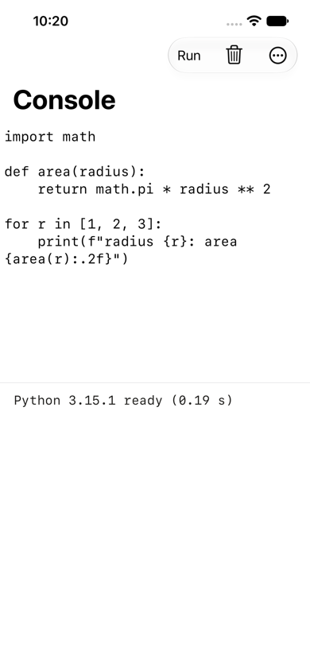 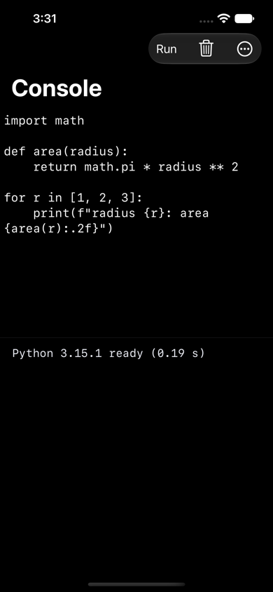

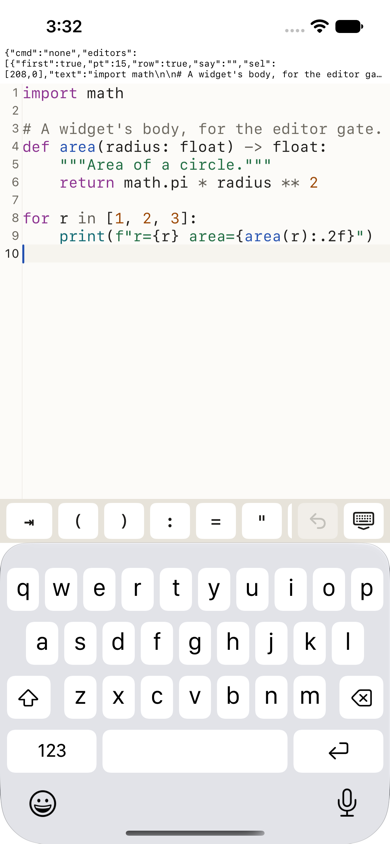 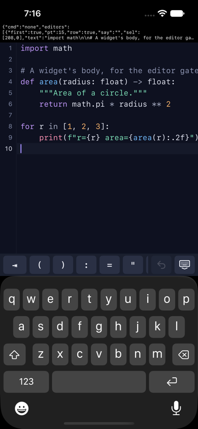

Note: the small block of text above the code in the "editor-gate" pictures (the key-row ones, the picture above this note) is the test's own readout, not part of the app. The Console screen shows the same key row without it.

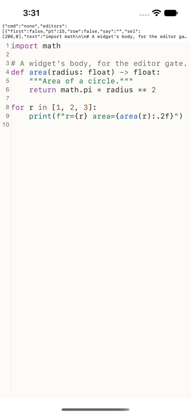 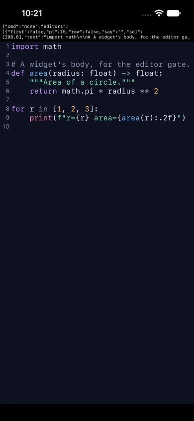

Behind it: the editor is a ready-made open-source component (software others wrote and share freely) called Runestone, wrapped so the company can swap it if it fails its checks (ADR-004). It is accepted only when three checks pass: speed on a long file (measured once; a second measure after adjustments is pending, T-0460), use with VoiceOver (the iPhone's spoken screen reader) and with the user's chosen text size, and use with an iPad's attached keyboard. The last two are not yet done (T-0460, Day 10; device checks T-0479 need a real device). Not yet in the editor: completion suggestions, find and replace, several scripts open in tabs, and tapping an error to jump to its line (T-0389).

## 2.4 Ready-made example scripts

The app carries ten example scripts, for instance a tip splitter, a word counter, a unit converter and a password generator. One opens in the editor like any script (the picture shows the start of it; the box scrolls):

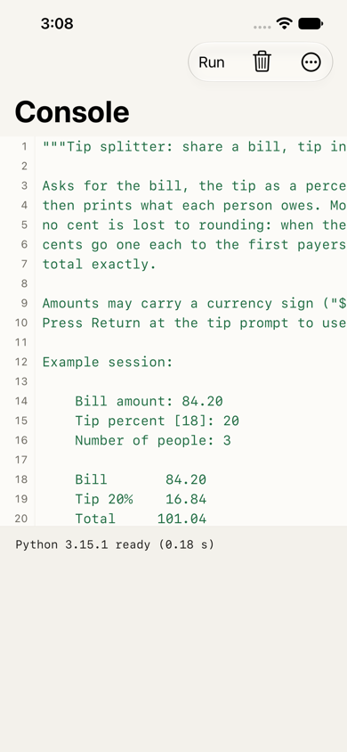 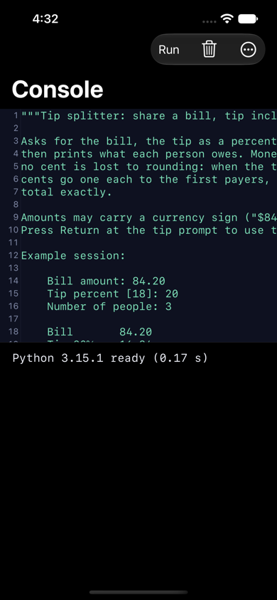

Behind it: examples are ordinary text files that ship inside the app. You can edit and run them; nothing is downloaded. The tip splitter will be rewritten to use the app's own pop-up questions once those exist (T-0458, after T-0447).

## 2.5 The "more" menu

The button with three dots opens a menu: Restart (starts Python afresh), Copy All (copies the console text), on iPad Open in New Window, and, when the open file declares a widget, Activity (that widget's recent runs). Acknowledgements and PyWidget Pro are no longer in it; they are rows in Settings.

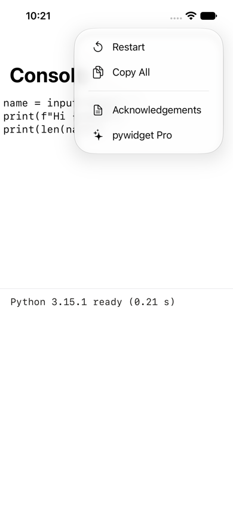 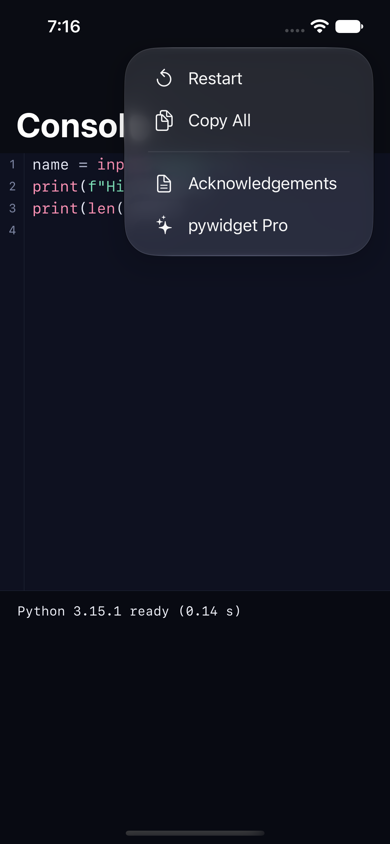

The pictures are older than the menu and still show the two rows that moved to Settings.

## 2.6 PyWidget Pro

The Pro screen opens from the PyWidget Pro row in Settings. It explains what the one purchase unlocks, and it shows a row only for a part of Pro this copy of the app has (the build's flag file turns each part on). Today that is one row, for the premade widgets the flag file marks Pro, shown as chips: only Habit tracker, on the Investors' list of November 18 (issue #324, option A). The other twelve premades built today are free for everyone. On this build Habit tracker, without Pro, cannot be put on the Home Screen, its settings page does not open, a Shortcut cannot run it, and its Gallery page has no Get (the button that copies a premade's code into a new project), so the row says what buying opens: "Add the Pro premades. Put them on your Home Screen with your own settings, run them from Shortcuts, and get a copy of their code in Projects." A box headed "Always free" reads "Running any Python, internet from your scripts, the editor and console, projects and files, and Shortcuts actions." A button ("Unlock Pro" and the price) buys it, and a link ("Restore purchase", for people who bought before on another device or after reinstalling) brings an earlier purchase back. The extra editor themes are decided as part of Pro and their picker is built (T-0272), but the flag file keeps them off until the Investors approve them, so the screen has no themes row.

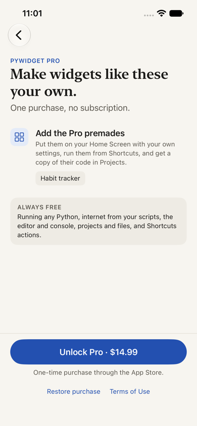 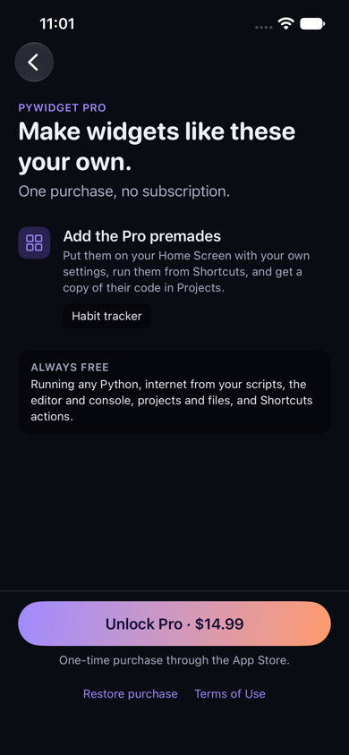

After a purchase the screen says "Pro is active" and "You can add the Pro premades to your Home Screen, run them from Shortcuts, and get a copy of their code in Projects.", with a button, "Open the Gallery", that leaves the Pro screen for the Gallery tab:

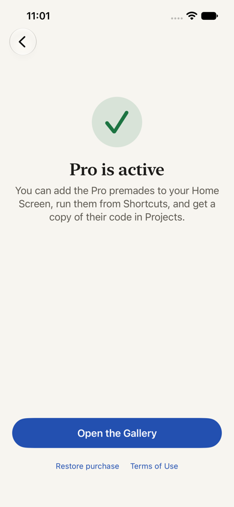 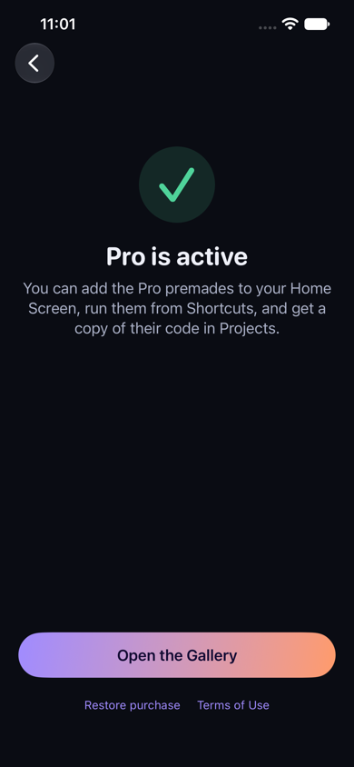

The four pictures above are older than these words; they show an earlier draft of the screen and are retaken with the next set of app pictures.

What changes next. Under the Investors' rule of November 17 (issue #41), every premade will work for everyone, anyone will set its inputs, and only changing a Pro premade's design, layout or code will need Pro (T-5654). When that lands nothing is locked, and the screen switches by itself to "Edit the Pro premades. Change their layout and design, or open their code and make your own version.", the free box adds "every premade with your own settings", and the line after a purchase becomes "You can edit every premade." No words change by hand.

The price on the screen comes from the App Store. In this build that is the test price list, set to $14.99, the price the Investors decided on 2026-10-30 (issue #87, option A); the price Apple charges is set in App Store Connect, which is the Investors' to do. Behind it: the app asks Apple's own purchase system, which charges you and tells the app the result; the app unlocks Pro only when Apple's reply checks out as genuine and the purchase has not been refunded. In this build, the purchase works only against the test file.

About the Pro words. Every word on the Pro screen is a draft that still needs the Investors' approval (the screen's word file says so on its first line). They are written once, in the design script, and copied into the app by a script, so the design sheets and the app say the same thing. A check reads every string and refuses a countdown, a number, an urgency word, and a buy button that does not show its price. How the screen picks its words is on the App page, under Purchases (pywidget/docs/how-it-works/purchases.md).

## 2.7 Acknowledgements

Open-source software the app is built on requires that its licence notices are shown. This screen lists them in two groups (Python itself, then add-on Python packages), and each opens as a page of licence text:

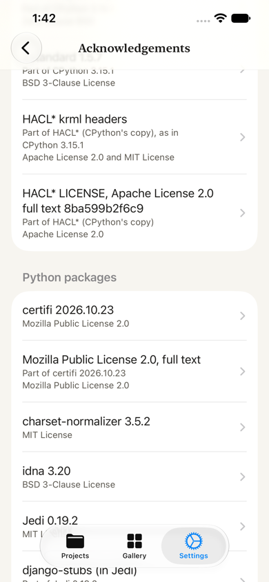 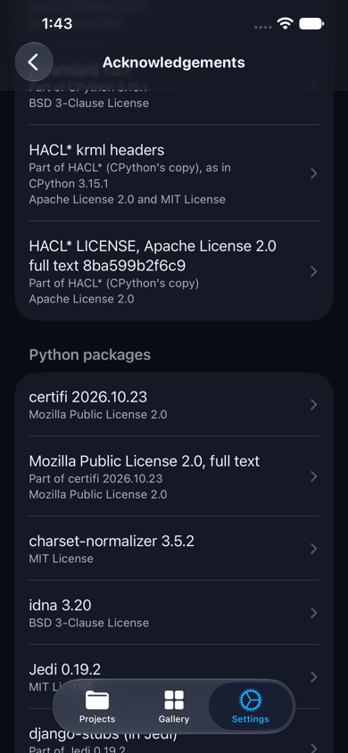

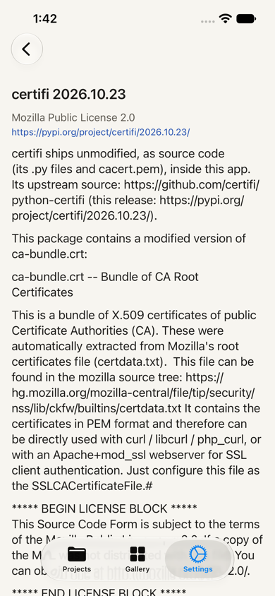 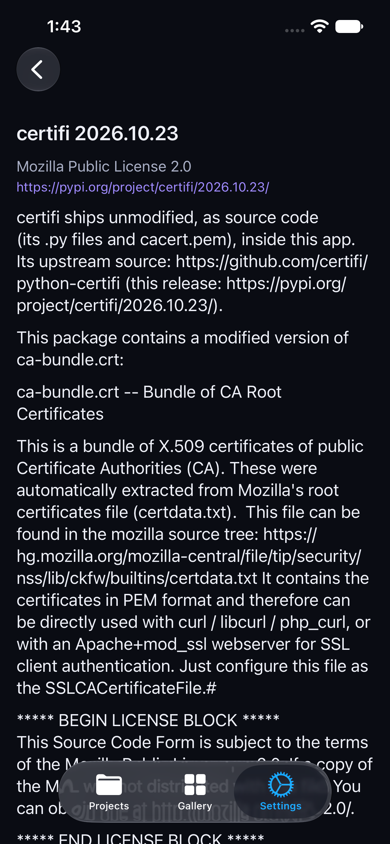

One row reads "Mozilla Public License 2.0, full text 2.0". It is meant to be there; the wording is a small slip. certifi (the add-on that holds the list of trusted web certificates, used for secure web addresses) is shared under the Mozilla Public License 2.0, and that licence asks for its full text to travel with the app. certifi's own download carries only a short notice, so the company added the full text as its own entry, marked "part of certifi" (decision ADR-003, Odalys's list of 27 October). certifi's page shows that text too. The slip is in how the list prints a row: name, then version. For a licence the version is already in its name, so "2.0" appears twice, and the row looks like one more package. The fix: such a row drops the version and says "Part of certifi" underneath. It is task T-0623, for Idris, with Odalys checking that the record still matches; the licence duty is met either way.

Behind it: the list is produced automatically from the company's record of every outside piece, so a piece cannot ship without its notice. An automatic check by Odalys compares the two, and a build that fails the check is not sent anywhere (ADR-003, 2026-10-27 ruling).

## 2.8 Screens not built yet

These have no picture because the screens do not exist. Each is marked in section 5 with its task and date. The Gallery (thirteen premades with live previews; Habit tracker, the one Pro premade, previewed without Pro) and Settings are built now; their own sections of this tour are still to be written.

- **Projects and Files**: folders of scripts, scripts that import each other, import and export of .py files and zips, opening a folder from the Files app. Task T-0355.
- **Widget preview beside the editor**: runs the script you are writing as a widget in every size. T-0192.
- **Pop-up questions from scripts**: alerts, text and number questions, forms, lists, a short toast message. T-0447.
- **The full-screen run screen and Home Screen scripts**: turn a script into an icon on the Home Screen that runs it full screen. T-0449 (the design for it exists).
- **Placing a widget from a tap**: see section 5, task T-0512, the most urgent open task.



