
<a class="back" href="{{ '/documents/pywidget/app-guide/' | relative_url }}">← App Guide</a><a href="{{ '/documents/pywidget/app-guide-02-screens.html' | relative_url }}" rel="bookmark">Permanent link</a>

GuideDay 9 · Fri Oct 30<code>pywidget/app-guide-02-screens.md</code>
<h1>App guide, part 2: A tour of every screen, in the order a new person meets it</h1>
By <a href="{{ '/cast/maren.html' | relative_url }}">Maren</a>, Product and visual designer


Part 2 of 10 of the pywidget app guide. The index, with the reading notes, is [app-guide.md](app-guide.html).

Decision records are named by number, for example ADR-001. The list is in section 4.

## 2.1 First-run tour: not built yet

A short tour is planned for the first launch, with a third page that lets you pick a date and watch a countdown widget redraw. Nothing exists yet. It comes after the gallery (T-0191); both are planned for Days 16 to 20 (2026-11-06 to 2026-11-10), and the freeze is Day 21. Task T-0193.

## 2.2 The Console: where you write and run

This is the screen the app opens on today. Your script (the text of your program, shown in a monospaced typeface) sits in the code editor at the top, coloured and with line numbers (section 2.3). At the bottom is the console, a strip of text where the script's output appears. When the app opens, the console says "Python 3.15.1 ready" and how long that took (about 0.2 seconds). Three buttons sit at the top right: Run, a bin that clears the console, and a "more" button (three dots in a circle). While a script runs, Run turns into Stop. The script in this picture asks for a name and then greets you.

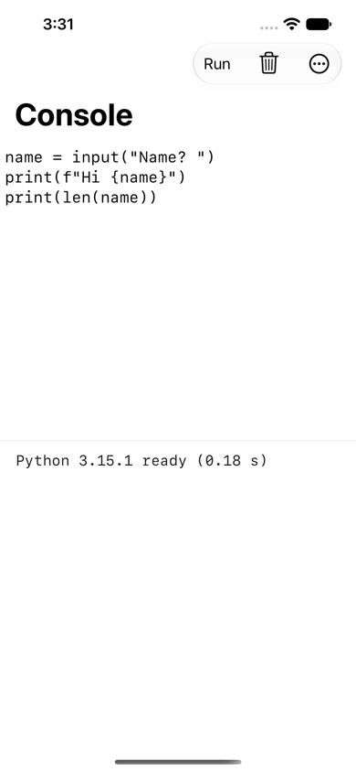 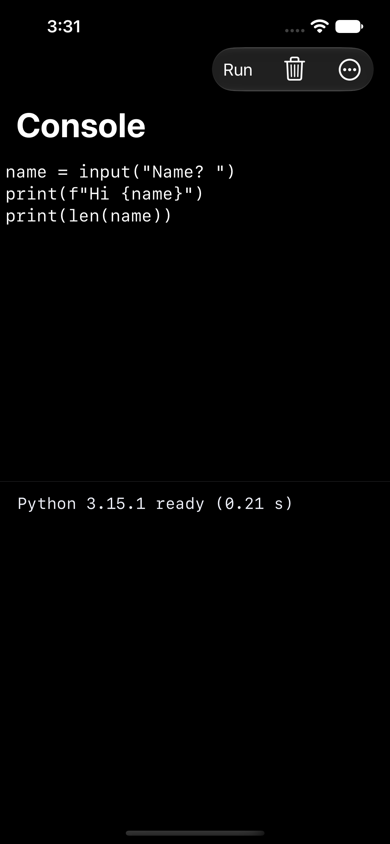

What you can do: type or paste a script, press Run, and read the output. What happens behind it: the app starts Python inside itself, runs your text, and shows everything the script prints in the console as it happens. No server is involved.

After Run, the console shows what the script printed and a line saying how long it took ("Finished in ..."):

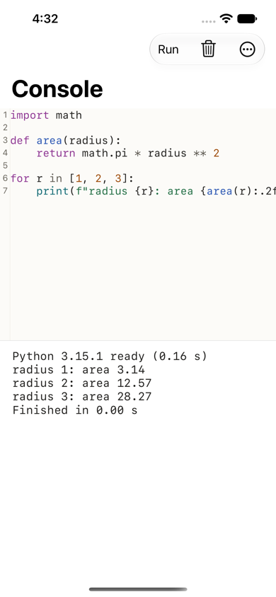 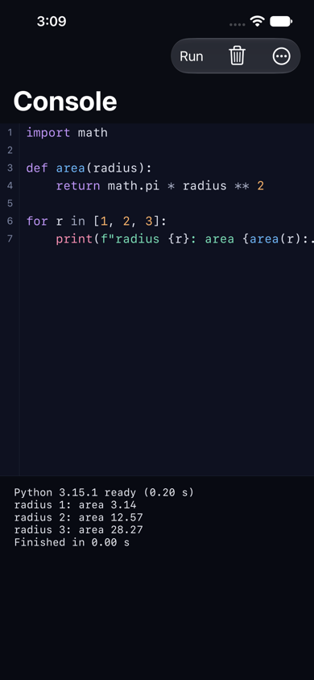

A script can ask you a question (Python's command for this is `input()`). The console then shows a rounded answer box labelled "input()" with a send arrow, the keyboard rises, and the script waits for your answer. The button at the top now says Stop:

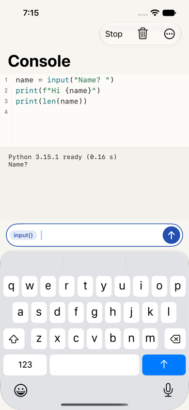 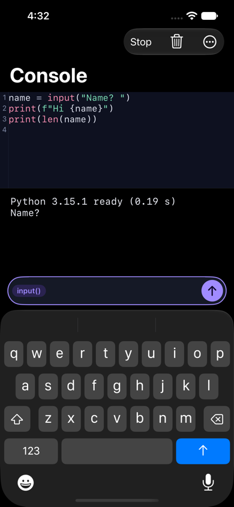

Behind it: the script is paused, not stopped, until you reply. Stop ends the run at any time.

## 2.3 The editor

Since 28 October 2026 (task T-0565, commit 5ac90a05) the box you type in on the Console screen is the real code editor. It colours the script by meaning (reserved words, text in quotes, numbers), numbers the lines, and adds a row of extra keys above the keyboard on iPhone for characters that are hard to reach (tab, brackets, colon, equals, quote mark, undo, and a button to hide the keyboard). With a hardware keyboard attached, the extra row stays hidden. The first picture is the Console screen itself; the other two come from a separate test screen that holds the same editor. The pictures were taken by an automatic test:

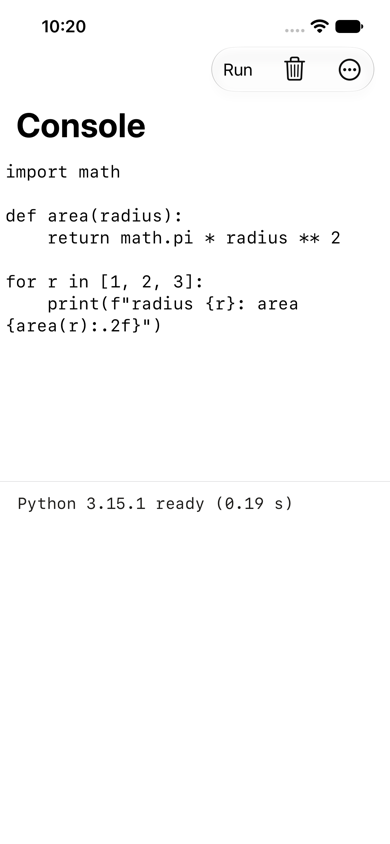 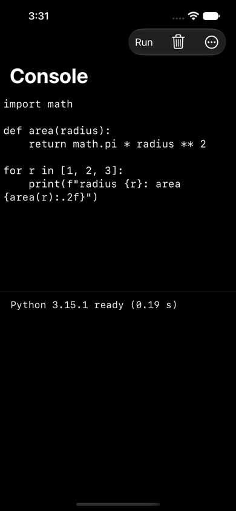

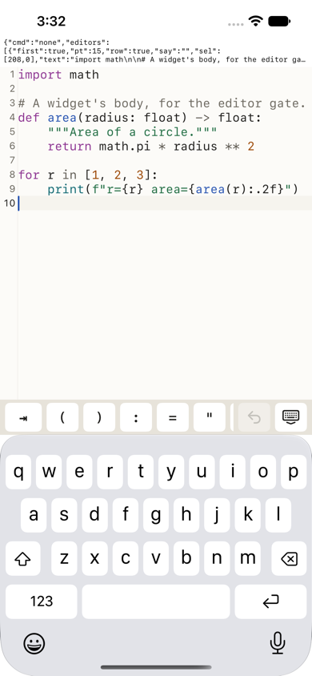 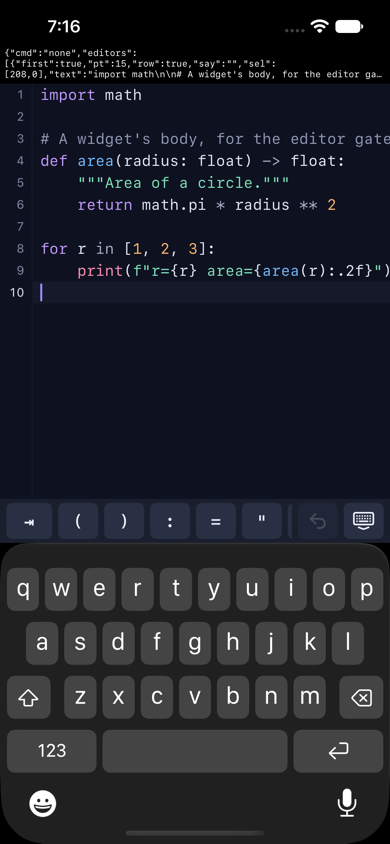

Note: the small block of text above the code in the "editor-gate" pictures (the key-row ones, the picture above this note) is the test's own readout, not part of the app. The Console screen shows the same key row without it.

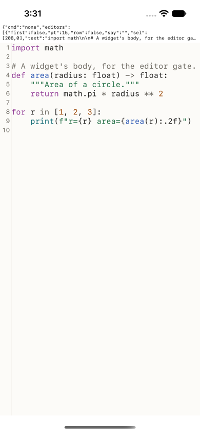 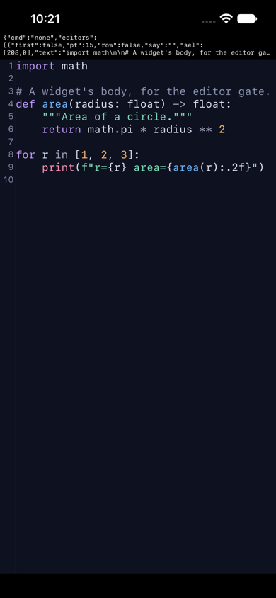

Behind it: the editor is a ready-made open-source component (software others wrote and share freely) called Runestone, wrapped so the company can swap it if it fails its checks (ADR-004). It is accepted only when three checks pass: speed on a long file (measured once; a second measure after adjustments is pending, T-0460), use with VoiceOver (the iPhone's spoken screen reader) and with the user's chosen text size, and use with an iPad's attached keyboard. The last two are not yet done (T-0460, Day 10; device checks T-0479 need a real device). Not yet in the editor: completion suggestions, find and replace, several scripts open in tabs, and tapping an error to jump to its line (T-0389).

## 2.4 Ready-made example scripts

The app carries ten example scripts, for instance a tip splitter, a word counter, a unit converter and a password generator. One opens in the editor like any script (the picture shows the start of it; the box scrolls):

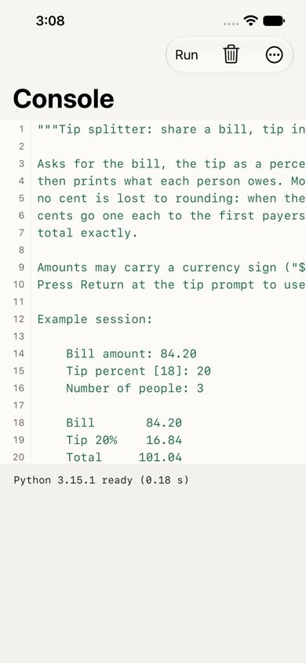 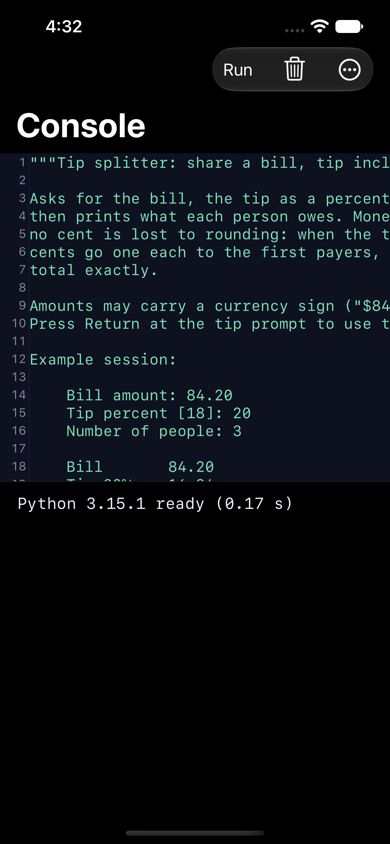

Behind it: examples are ordinary text files that ship inside the app. You can edit and run them; nothing is downloaded. The tip splitter will be rewritten to use the app's own pop-up questions once those exist (T-0458, after T-0447).

## 2.5 The "more" menu

The button with three dots opens a menu: Restart (starts Python afresh), Copy All (copies the console text), then, below a line, Acknowledgements and pywidget Pro.

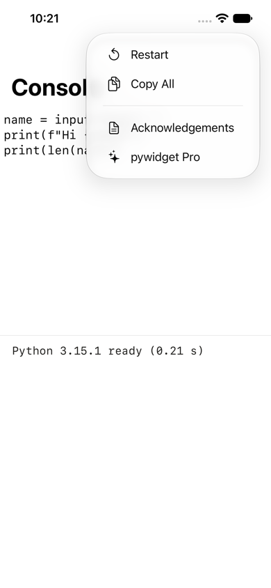 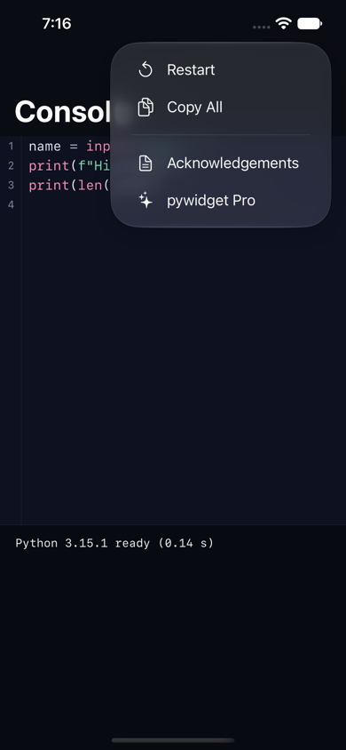

This is a stopgap. The plan puts these in a Settings screen, which does not exist yet (section 5).

## 2.6 pywidget Pro

The Pro screen explains what the one purchase unlocks: the seven premade widgets that are not free (Habit tracker, Shortcuts launcher, Storage, Day progress, Quote of the day, World clocks, GitHub repository). A box says what stays free: running any Python, the editor and console, projects and files, Shortcuts actions, the device features, your own widgets and the five free premades. A blue button ("Unlock Pro") buys it; the extra editor themes are decided as part of Pro but are not yet in the build or on this screen (T-0769, T-0272); a link ("Restore purchase", for people who bought before on another device or after reinstalling) brings an earlier purchase back.

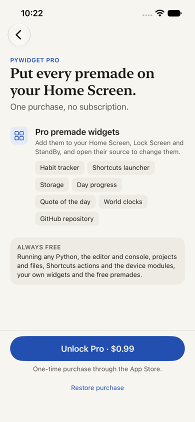 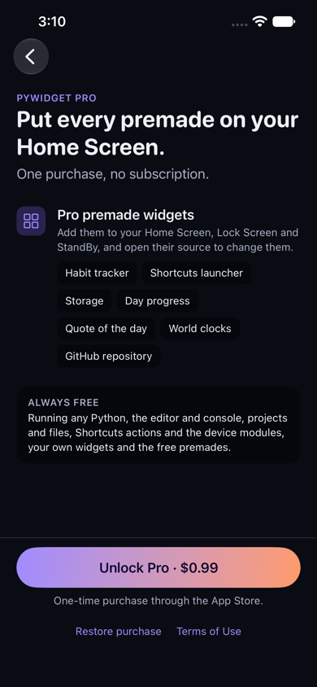

After a purchase the screen says "Pro is active" with a green tick. Its line says the Pro premades are "open in the Gallery", and the Gallery does not exist yet (section 2.8). There is no button to it, because the app only shows that button where the Gallery can be reached:

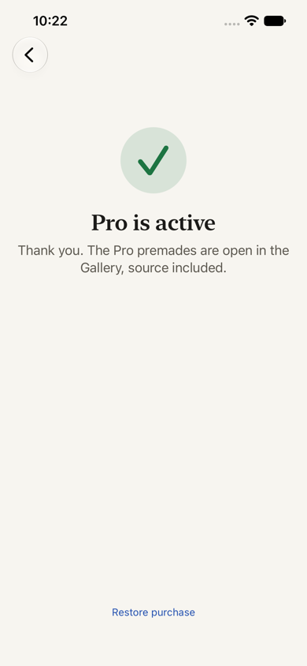 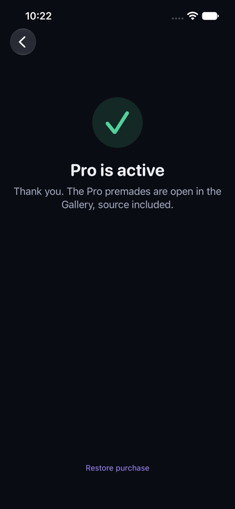

Important: the price shown in the app today ($0.99) comes from a stand-in test price list. The Investors decided on 2026-10-30 (issue #87, option A, "approve 87 91"): Pro is one purchase at $14.99, with the 7 Pro premades and the 3 editor themes. That price is not in the app at HEAD; T-0769 puts it in after the alpha commit (2026-10-31 12:00 PM), and the price Apple charges is set in App Store Connect, which is not done. Behind it: the app asks Apple's own purchase system, which charges you and tells the app the result; the app unlocks Pro only when Apple's reply checks out as genuine and the purchase has not been refunded. In this build, the purchase works only against the test file; the real store listing does not exist until the Investors' Apple accounts are ready (membership due Day 7, 2026-10-28; Paid Apps Agreement Day 12, 2026-11-02).

About the Pro words, and why they are not changed now. Every word on the Pro screen is a draft that still needs the Investors' approval (the screen's word file says so on its first line). The style guide approved the app's two looks, not the Pro screen beyond its shared colours and type, so the Pro screen's look and words go to the Investors as one request, with pictures, before anything is sent to Apple (task T-0625: Maren drafts, Ines posts). "Gallery" itself is not new: it is the name of the premade shelf in the approved mockups, so using it needs no new approval. Renaming it would be a new decision and would go in that request. The two sentences that run ahead of the build:

- "The Pro premades are open in the Gallery" is true only once the Gallery is built (T-0191; not at HEAD, planned Days 16 to 20). The alpha on Day 10 is an internal test build, so the line stays for it. If the Gallery is moved to version 1.1 at its check (freeze row F6, 2 November), the line changes to one that does not name it, before the freeze. That is task T-0624, for Maren and Idris.
- "Put every premade on your Home Screen" is true once a tap puts a widget on the Home Screen (T-0512, built 2026-10-29: the app now writes a placed Python widget's picture itself; what remains is T-0684) and Pro premades can be placed and locked again after a refund (T-0051). If Pro premades are cut from 1.0, the Pro screen drops this headline by itself, because it only shows the parts of Pro that the build switches on.

## 2.7 Acknowledgements

Open-source software the app is built on requires that its licence notices are shown. This screen lists them in two groups (Python itself, then add-on Python packages), and each opens as a page of licence text:

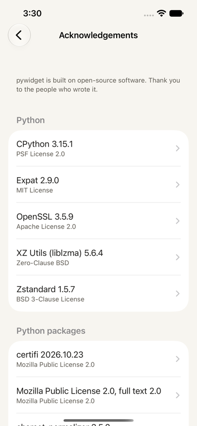 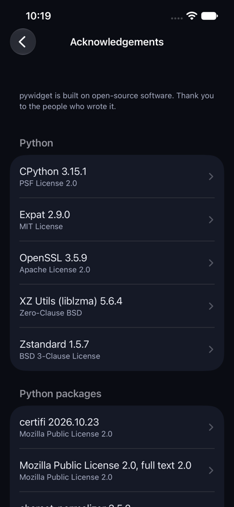

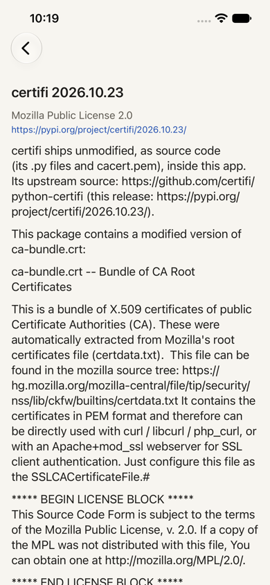 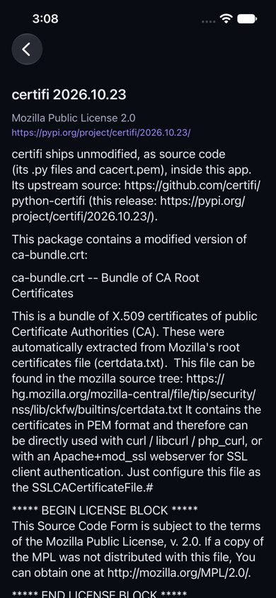

One row reads "Mozilla Public License 2.0, full text 2.0". It is meant to be there; the wording is a small slip. certifi (the add-on that holds the list of trusted web certificates, used for secure web addresses) is shared under the Mozilla Public License 2.0, and that licence asks for its full text to travel with the app. certifi's own download carries only a short notice, so the company added the full text as its own entry, marked "part of certifi" (decision ADR-003, Odalys's list of 27 October). certifi's page shows that text too. The slip is in how the list prints a row: name, then version. For a licence the version is already in its name, so "2.0" appears twice, and the row looks like one more package. The fix: such a row drops the version and says "Part of certifi" underneath. It is task T-0623, for Idris, with Odalys checking that the record still matches; the licence duty is met either way.

Behind it: the list is produced automatically from the company's record of every outside piece, so a piece cannot ship without its notice. An automatic check by Odalys compares the two, and a build that fails the check is not sent anywhere (ADR-003, 2026-10-27 ruling).

## 2.8 Screens not built yet

These have no picture because the screens do not exist. Each is marked in section 5 with its task and date.

- **Projects and Files**: folders of scripts, scripts that import each other, import and export of .py files and zips, opening a folder from the Files app. Task T-0355.
- **The premade gallery**: a shelf of the 12 premade widgets with live previews, where the free ones can be added and Pro ones are previewed. T-0191.
- **Widget preview beside the editor**: runs the script you are writing as a widget in every size. T-0192.
- **Settings**: Acknowledgements, Pro and (only if the Investors approve) an editor theme picker will live here. Specified; T-0042 and T-0272.
- **Pop-up questions from scripts**: alerts, text and number questions, forms, lists, a short toast message. T-0447.
- **The full-screen run screen and Home Screen scripts**: turn a script into an icon on the Home Screen that runs it full screen. T-0449 (the design for it exists).
- **Placing a widget from a tap**: see section 5, task T-0512, the most urgent open task.



