
<a class="back" href="{{ '/documents/pywidget/app-guide/' | relative_url }}">← App Guide</a><a href="{{ '/documents/pywidget/app-guide-06-design-choices.html' | relative_url }}" rel="bookmark">Permanent link</a>

GuideDay 9 · Fri Oct 30<code>pywidget/app-guide-06-design-choices.md</code>
<h1>App guide, part 6: Design choices</h1>
By <a href="{{ '/cast/maren.html' | relative_url }}">Maren</a>, Product and visual designer


Part 6 of 10 of the pywidget app guide. The index, with the reading notes, is [app-guide.md](app-guide.html).

Every look-and-feel decision made for the app, with the pictures that exist for it. Each is marked **approved** (an Investor said yes in writing; the words and the link are in `creative/approved.md`) or **pending** (shown to the Investors, no answer yet, so nothing here is decided). These pictures are drawings made by the company's own scripts from the colours and type in the design files, not photos of the running app, and no image-making AI was used (Commandment 9). The screens in section 2 are the real app; these show what was proposed or approved. This section is the one place that lists them, and it is updated as decisions land.

## Approved

**6.1 Light and dark look: "Paper" and "Studio" (issue #60). Approved 2026-10-25.** The app has two looks and follows the phone's Light/Dark setting: Paper (light, a serif heading face) and Studio (dark, a rounded heading face). There is no in-app switch. Pictures: the Console in light and dark.

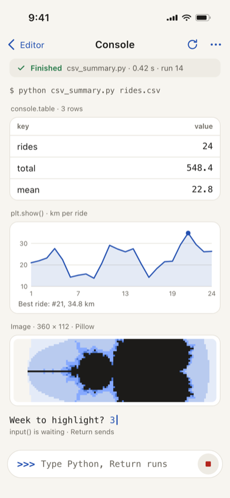 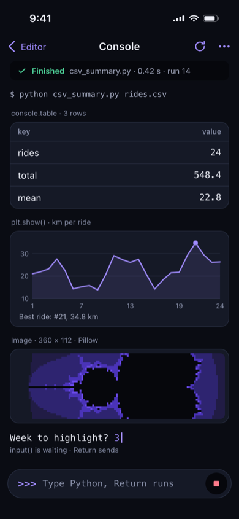

**6.2 The Pro purchase screen: its look and words (issue #94). Approved 2026-10-28.** The screen that offers pywidget Pro, and the small entry points to it. The price and what Pro contains were not part of this approval; issue #87 decided them on 2026-10-30 (one purchase, $14.99, 7 Pro premades and 3 themes).

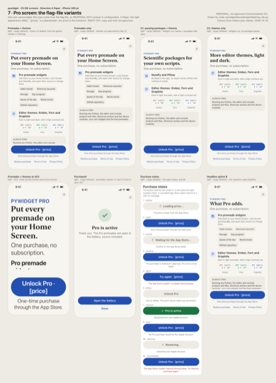 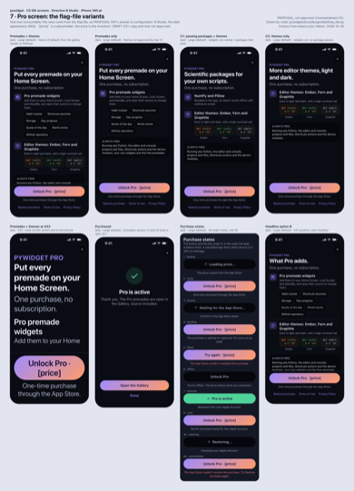

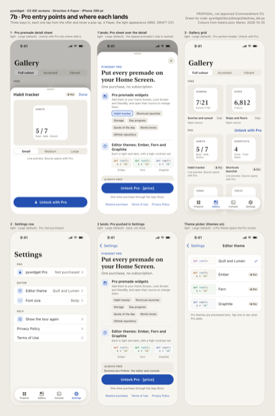 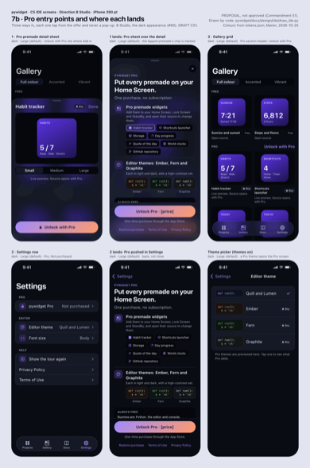

**6.3 Colour of search matches in the code editor (issue #95). Approved 2026-10-28.** Every match gets a pale amber tint; the current match keeps the selection colour. One picture, with the options that were compared.

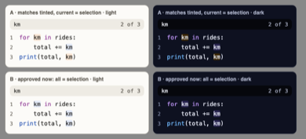

**6.4 Three extra editor colour themes: Ember, Fern, Graphite (issue #93). Approved 2026-10-28.** Each comes as a light and a dark pair. They are part of Pro (decided 2026-10-30, issue #87); the theme picker is not built yet (T-0272).

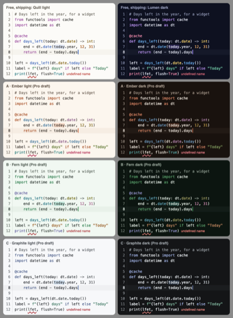

**6.5 The website's chat page and Now panel (issue #29). Approved 2026-10-25.** This is the company's website, not the app, so no picture is repeated here; the approval record is in `creative/approved.md`.

## Pending: waiting for the Investors

**6.6 The app icon (issue #92, open, answer wanted by 2026-11-02).** Three directions, each in light, dark and tinted: Indent (the company's recommendation), Prompt and Trace. Nothing is decided, and the icon in test builds is a plain placeholder. How each one is built from numbers and formulas is in section 7. Shown at their real small size (60 pixels), top row Indent, then Prompt, then Trace; each row is light, dark, tinted.

  

 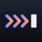 

  

**6.7 The App Store screenshots (issue #92, open, same card).** Two layouts are proposed, "Open" (recommended) and "Framed". Gap: no contact sheet for either layout is in the repository at HEAD, so there is no picture here. The real screenshots are taken from the running app after the feature freeze (Day 21, 2026-11-11), not on the Day 13 of the earlier plan; the date the Investors review them is not set in the current plan.

**6.8 The app's public name (issue #90, open, answer wanted by 2026-11-02).** Three coined names are on the card (Coilwork is recommended). Gap: there is no picture of the three names. The only picture that exists is of how the placeholder name "pywidget" or "PyWidget" would be written under the icon and in copy (option E on the card).

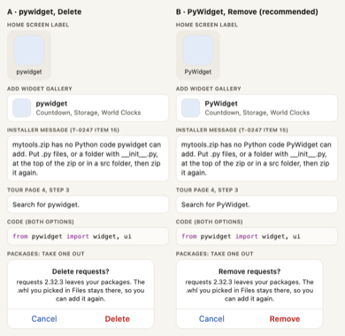

**6.9 Other screens drawn but not yet built or not separately approved.** These are drawings of the home, run, settings and gallery screens and of the Home Screen widget states. They are drawn from the approved colours of 6.1, but no Investor decision on them is recorded, so they are shown as pending and nothing in them is final. The real versions, where built, are in section 2.

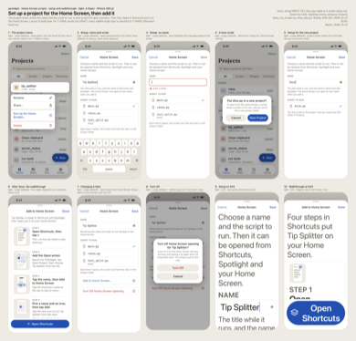 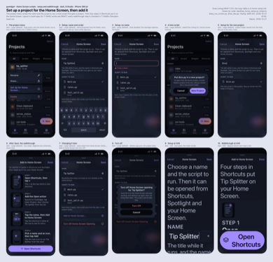

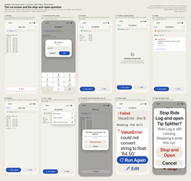 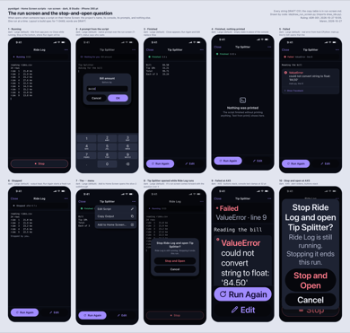

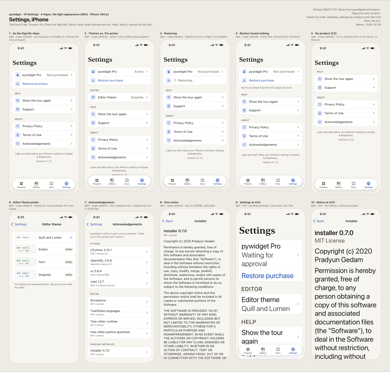 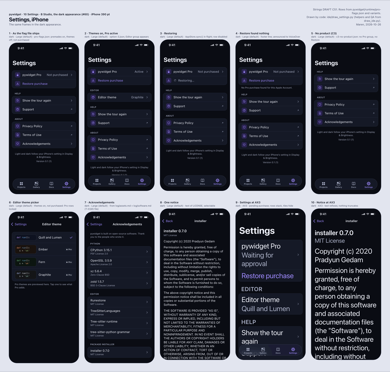

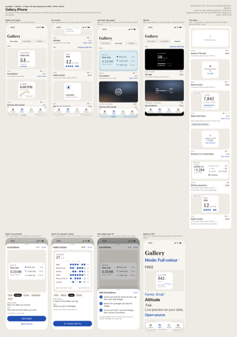 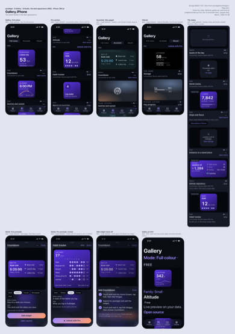

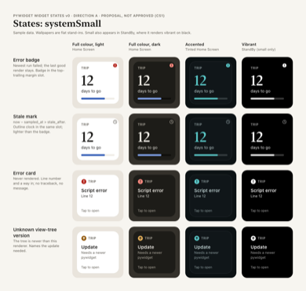

Not design choices and so not listed: the privacy policy facts (issue #98) have no pictures.



