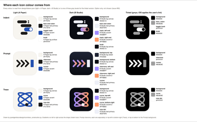
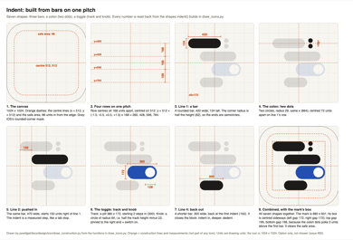
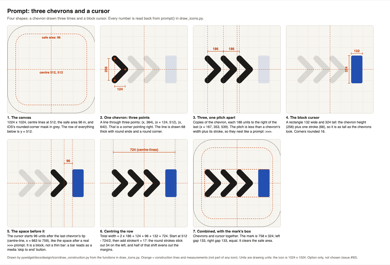
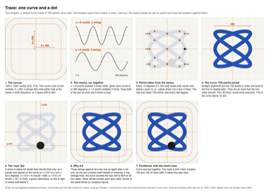
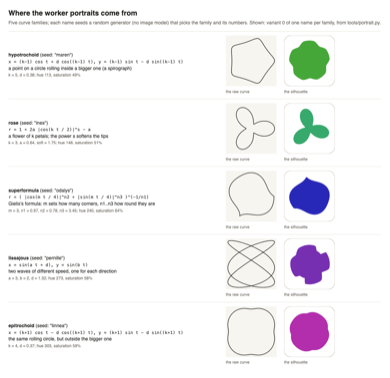

<div class="crumbs" role="navigation" aria-label="Back"><a class="back" href="{{ '/documents/pywidget/app-guide/' | relative_url }}">← App Guide</a><a href="{{ '/documents/pywidget/app-guide-07-pictures-in-code.html' | relative_url }}" rel="bookmark">Permanent link</a></div>
<div class="page-head"><div class="kicker"><span class="kind grey">Guide</span><span>Day 9 · Fri Oct 30</span><span><code>pywidget/app-guide-07-pictures-in-code.md</code></span></div><h1>App guide, part 7: How the pictures are made in code</h1><div class="byline"><span>By <a href="{{ '/cast/maren.html' | relative_url }}">Maren</a>, Product and visual designer</span></div></div>

<style>.doc-body{overflow-wrap:break-word}.doc-src{overflow-wrap:anywhere}.tbl[data-n~="1"] tr>:nth-child(1),.tbl[data-n~="2"] tr>:nth-child(2),.tbl[data-n~="3"] tr>:nth-child(3),.tbl[data-n~="4"] tr>:nth-child(4),.tbl[data-n~="5"] tr>:nth-child(5),.tbl[data-n~="6"] tr>:nth-child(6),.tbl[data-n~="7"] tr>:nth-child(7),.tbl[data-n~="8"] tr>:nth-child(8),.tbl[data-n~="9"] tr>:nth-child(9),.tbl[data-n~="10"] tr>:nth-child(10),.tbl[data-n~="11"] tr>:nth-child(11),.tbl[data-n~="12"] tr>:nth-child(12){min-width:0;overflow-wrap:normal}.tbl[data-o="1"] tr>:nth-child(1),.tbl[data-o="2"] tr>:nth-child(2),.tbl[data-o="3"] tr>:nth-child(3),.tbl[data-o="4"] tr>:nth-child(4),.tbl[data-o="5"] tr>:nth-child(5),.tbl[data-o="6"] tr>:nth-child(6),.tbl[data-o="7"] tr>:nth-child(7),.tbl[data-o="8"] tr>:nth-child(8),.tbl[data-o="9"] tr>:nth-child(9),.tbl[data-o="10"] tr>:nth-child(10),.tbl[data-o="11"] tr>:nth-child(11),.tbl[data-o="12"] tr>:nth-child(12){position:sticky;right:0;overflow-wrap:normal;background:var(--page);box-shadow:-1px 0 var(--line),-9px 0 8px -8px var(--sh)}</style>
<div class="doc-body" markdown="1">


Part 7 of 10 of the pywidget app guide. The index, with the reading notes, is [app-guide.md](app-guide.html).

Investor question (issue #41, an Investor): how mathematics is used to create each designed icon, with the exact functions, and a picture of how every element is used. This section answers it. It describes what the code does as written on 29 October 2026 (Commandment 33), and every picture here comes from a script you can read and run (Commandment 9). No image-making AI, stock art, font glyph or photo is in any of them. The three icon options are **options only**. Nothing here says which one is chosen: that is the Investors' call on issue #92 (<span title="Commandment 51: the Investors approve every visual before it ships.">Commandment 51</span>).

Scripts, all in `pywidget/docs/design/icon/` and run from any folder:

- `draw_icons.py OUTDIR` makes the icons themselves (the file the question is about).
- `draw_construction.py` makes the construction strips and the colour sheet below. It calls the same `indent()`, `prompt()` and `trace()` functions as the icons and draws the shapes they return, so a strip cannot disagree with an icon. It also checks its own copies of the Trace numbers against the icon's.
- `draw_portrait_families.py` makes the portrait picture in 7.5.

## 7.1 The ground rules, before any icon

**The page is a square of numbers.** An icon is a list of shapes, each described by plain numbers on a square sheet 1024 units wide and 1024 tall (the App Store size is 1024 pixels, so one unit is one pixel there). The point (0, 0) is the top-left corner and **y grows downward**, as on every screen. The middle is (512, 512). The code that writes this is `svg()` in `draw_icons.py`: it puts a background rectangle and then the shapes in a file format called SVG, a text file of shapes. A headless copy of the Chromium browser then turns the text into pixels; it only paints, it does not invent anything.

**Two guard rails, both measured from the shapes.** The *mask* is the rounded corner iOS cuts every icon with; the code stands in for Apple's curve with a rounded square whose corner radius is 0.2237 x 1024 = 229 units. The *safe area* is a margin of 96 units: every corner of the drawing must sit at least 96 units inside the mask. `qa_for()` checks this for each file, and the result today is 0 faults.

**Five small tools build every shape.** Each one writes one SVG shape and also reports the box it covers (used for the checks).

```python
def bar(x0, x1, yc, h, fill):
    return {"svg": f'<rect x="{x0}" y="{yc-h/2}" width="{x1-x0}" height="{h}" rx="{h/2}" fill="{fill}"/>',
            "bbox": (x0, yc - h / 2, x1, yc + h / 2), "min": h, "fill": fill}


def dot(cx, cy, r, fill):
    return {"svg": f'<circle cx="{cx}" cy="{cy}" r="{r}" fill="{fill}"/>',
            "bbox": (cx - r, cy - r, cx + r, cy + r), "min": 2 * r, "fill": fill}


def rect(x, y, w, h, rx, fill):
    return {"svg": f'<rect x="{x}" y="{y}" width="{w}" height="{h}" rx="{rx}" fill="{fill}"/>',
            "bbox": (x, y, x + w, y + h), "min": min(w, h), "fill": fill}


def stroke_path(pts, width, stroke, closed=False, fill_for_qa=None):
    d = "M" + " L".join(f"{x:.1f},{y:.1f}" for x, y in pts) + (" Z" if closed else "")
    xs, ys = [p[0] for p in pts], [p[1] for p in pts]
    w2 = width / 2
    return {"svg": f'<path d="{d}" fill="none" stroke="{stroke}" stroke-width="{width}" '
                   f'stroke-linecap="round" stroke-linejoin="round"/>',
            "bbox": (min(xs) - w2, min(ys) - w2, max(xs) + w2, max(ys) + w2), "min": width,
            "fill": fill_for_qa or stroke}


def lin_grad(gid, c0, c1, x1="0", y1="0", x2="1", y2="1"):
    return (f'<linearGradient id="{gid}" x1="{x1}" y1="{y1}" x2="{x2}" y2="{y2}">'
            f'<stop offset="0" stop-color="{c0}"/><stop offset="1" stop-color="{c1}"/></linearGradient>')
```

Plain English:

- `bar(x0, x1, yc, h, fill)` is a pill: it runs from x0 to x1, is centred on height `yc`, is `h` tall, and its corner radius `rx = h/2` is half its height, so both ends are perfect half-circles.
- `dot(cx, cy, r, fill)` is a circle with centre (cx, cy) and radius r.
- `rect(...)` is a rectangle with rounded corners of radius `rx`.
- `stroke_path(pts, width, ...)` is a line drawn through a list of points with a pen of the given width; round ends and round joins. Its box is the points' box widened by half the pen width on every side.
- `lin_grad(...)` is a blend between two colours. The four numbers are where the blend starts and ends as fractions of the shape's own box: (0, 0) to (1, 0) is left to right, (0, 0) to (0, 1) is top to bottom, (0, 0) to (1, 1) is corner to corner.

**Where the colours come from.** Nothing is picked by eye in the icon file. `TOK` reads `design/tokens.json`, the same colour file the app uses. The *light* icon takes its colours from palette A "Paper", the *dark* icon from palette B "Studio" (the pair approved in issue #60). The *tinted* icon is different: since iOS 18 the system asks for a grey picture and paints it in the user's chosen tint, brightest grey meaning most important. So the code uses three fixed greys: white `#FFFFFF`, mid grey `#9E9E9E`, black `#000000`. The sheet shows every colour, its role and where it comes from.

<p class="guide-shots"></p>

**How contrast is checked.** Each icon colour pair (mark against its background) must reach at least 3 to 1, the usual minimum for graphics that are not text. The code does it with two functions:

```python
def lum(hexc):
    h = hexc.lstrip("#")
    c = [int(h[i:i + 2], 16) / 255 for i in (0, 2, 4)]
    c = [v / 12.92 if v <= 0.04045 else ((v + 0.055) / 1.055) ** 2.4 for v in c]
    return 0.2126 * c[0] + 0.7152 * c[1] + 0.0722 * c[2]


def ratio(a, b):
    la, lb = sorted((lum(a), lum(b)), reverse=True)
    return round((la + 0.05) / (lb + 0.05), 2)
```

In words: each colour channel (red, green, blue) is first written as a number from 0 to 1, then the screen's brightness curve ("gamma") is undone: values at or below 0.04045 are divided by 12.92, larger ones become `((v + 0.055) / 1.055)` raised to the power 2.4. The three results are added in the proportions 0.2126, 0.7152 and 0.0722, because the eye is most sensitive to green. That sum is the colour's *relative luminance* L, from 0 (black) to 1 (white). The *contrast ratio* is `(L_lighter + 0.05) / (L_darker + 0.05)`, so black on white is 21 to 1 and identical colours are 1 to 1. Lowest ratio per icon in `qa.json`: Indent 6.77 (light), 7.10 (dark), 7.84 (tinted); Prompt 6.77, 5.68, 7.84; Trace 6.77, 7.10, 7.84. Where a colour is a blend, both ends are checked.

## 7.2 Option 1, Indent (the company's recommendation)

**The idea.** Four lines of code drawn as bars: a line that ends in a colon, a line pushed in, a deeper line that is a live switch, and a line pulled back out. Python is read by its indentation, so the shape of the code is the picture.

**The exact function** (`indent(app)`, comments as written):

```python
# ------------------------------------------------------------ direction 1: Indent
# A block of code read as shapes: a line ending in a colon, an indented line,
# a deeper line that is a live toggle, a dedent. Python's structure is its
# indentation; the innermost line is the thing you can tap on the Home Screen.
def indent(app):
    defs, acc_stops = "", None
    if app == "light":      # A Paper: ink bars on paper, the ink-blue toggle
        bg, ink, acc, knob = A_L["bg.canvas"], A_L["text.primary"], A_L["accent"], A_L["bg.surface"]
    elif app == "dark":     # B Studio: pale bars on night, the violet-to-coral toggle
        defs = lin_grad("t", B_D["accent"], B_D["accent.2"], "0", "0", "1", "0")
        bg, ink, acc, knob = B_D["bg.canvas"], B_D["text.primary"], "url(#t)", B_D["bg.canvas"]
        acc_stops = (B_D["accent"], B_D["accent.2"])
    else:
        bg, ink, acc, knob = T_BG, T_MID, T_HI, T_BG
    H, step, ind, th = 124, 168, 150, 172          # bar height, line pitch, indent, toggle height
    x0 = 512 - (2 * ind + 380) / 2                    # centre the widest line (the toggle row)
    ys = [512 - 1.5 * step, 512 - 0.5 * step, 512 + 0.5 * step, 512 + 1.5 * step]
    els = [
        bar(x0, x0 + 420, ys[0], H, ink),
        dot(x0 + 492, ys[0] - 36, 29, ink),        # colon: two dots
        dot(x0 + 492, ys[0] + 36, 29, ink),
        bar(x0 + ind, x0 + ind + 470, ys[1], H, ink),
        dict(bar(x0 + 2 * ind, x0 + 2 * ind + 380, ys[2], th, acc), fill=(acc_stops or [acc])[0]),  # toggle track
        dot(x0 + 2 * ind + 380 - th / 2, ys[2], th / 2 - 22, knob),   # toggle knob (on)
        bar(x0 + ind, x0 + ind + 300, ys[3], H, ink),
    ]
    stops = acc_stops or (acc,)
    pairs = [("ink", ink, bg)] + [("toggle " + c, c, bg) for c in stops] + [("knob on " + c, knob, c) for c in stops]
    return {"bg": bg, "defs": defs, "bg_fill": bg, "els": els, "pairs": pairs}
```

**The math, step by step.**

1. **Constants.** `H = 124` (bar height), `step = 168` (distance from one line to the next), `ind = 150` (how far each indent moves right), `th = 172` (toggle height).
2. **Rows.** The four row heights are `512 - 1.5 x 168`, `512 - 0.5 x 168`, `512 + 0.5 x 168`, `512 + 1.5 x 168` = 260, 428, 596, 764. The multipliers -1.5, -0.5, +0.5, +1.5 are symmetrical around zero, so the block is centred top to bottom by construction.
3. **Left edge.** `x0 = 512 - (2 x 150 + 380) / 2 = 172`. The widest line is the toggle row, which starts two indents in (300) and is 380 wide, so 680 units; half of that on each side of 512 gives the left edge 172 and the right edge 852.
4. **The lines.** Line 1 runs from 172, 420 wide. Line 2 starts one indent in (172 + 150 = 322) and is 470 wide. The toggle track starts two indents in (472), is 380 wide and 172 tall. Line 4 starts at 322 again and is 300 wide: the "dedent".
5. **The colon.** Two dots of radius 29 at x = 172 + 492 = 664, 72 apart (36 above and below line 1's centre).
6. **The knob.** A circle whose radius is half the track height minus 22: 172 / 2 - 22 = 64. Its centre is at the track's right end minus its half-height, so it sits at the right end of the track: the switch reads as "on".
7. **<span title="Whether we may and can build it: our rules and banned areas, and a first version Idris can finish by Day 22. A subject off the Investors&#x27; list is noted, not dropped.">Fit</span>.** The mark is 680 wide and 631 tall (195 to 826), 172 units from each side; the colon dots poke 3 units above the first bar, which is why the top gap is 195 and the bottom 198.

**Colour.** Light: background `bg.canvas`, bars `text.primary`, track `accent`, knob `bg.surface`. Dark: the track is a left-to-right blend from Studio `accent` (violet) to `accent.2` (coral); the knob is the background colour, so it looks cut out. Tinted: bars mid grey, track white (brightest, because it is the point of the picture), knob black.

<p class="guide-shots"></p>

Reading the strip: panel 1 is the sheet with the safe area; 2 the four rows on one <span title="A memo that proposes one idea to the Investors as the product. Only a B or better becomes one.">pitch</span>; 3 to 7 each element alone (the rest ghosted) with its measurements; 8 everything together with the mark's box.

## 7.3 Option 2, Prompt

**The idea.** The three chevrons `>>>` of Python's interactive prompt, followed by a waiting block cursor.

**The exact function** (`prompt(app)`):

```python
def prompt(app):
    defs = ""
    if app == "light":      # A Paper: ink chevrons on paper, the ink-blue block cursor
        bg, bg_stops, chev, caret = A_L["bg.canvas"], (A_L["bg.canvas"],), A_L["text.primary"], A_L["accent"]
    elif app == "dark":     # B Studio: gradient chevrons on the night surface, a pale cursor
        defs = lin_grad("g", B_D["bg.raised"], B_D["bg.canvas"], "0", "0", "0", "1") + \
               lin_grad("s", B_D["accent"], B_D["accent.2"], "0", "0", "1", "0")
        bg, bg_stops, chev, caret = "url(#g)", (B_D["bg.raised"], B_D["bg.canvas"]), "url(#s)", B_D["text.primary"]
    else:
        bg, bg_stops, chev, caret = T_BG, (T_BG,), T_HI, T_MID
    sw, hh, cw, pitch = 68, 128, 124, 186        # stroke, half height, chevron width, pitch
    blk_w, space = 132, 96                       # block cursor width, the space after the prompt
    width = 2 * pitch + cw + space + blk_w
    x0, yc = 512 - width / 2 + sw / 4, 512
    els = []
    for i in range(3):
        x = x0 + i * pitch
        q = [(x, yc - hh), (x + cw, yc), (x, yc + hh)]
        fq = (B_D["accent"] if i == 0 else B_D["accent.2"]) if app == "dark" else None
        els.append(stroke_path(q, sw, chev, fill_for_qa=fq))
    # A block cursor (not a bar): a bar after chevrons reads as "skip to end".
    els.append(rect(x0 + 2 * pitch + cw + space, yc - hh - sw / 2, blk_w, 2 * hh + sw, 16, caret))
    pairs = [("chevron vs bg " + c, (B_D["accent"] if app == "dark" else chev), c) for c in bg_stops]
    if app == "dark":
        pairs += [("chevron end vs bg " + c, B_D["accent.2"], c) for c in bg_stops]
    pairs += [("caret vs bg " + c, caret, c) for c in bg_stops]
    return {"bg": bg, "defs": defs, "bg_fill": bg_stops[0], "els": els, "pairs": pairs}
```

**The math, step by step.**

1. **Constants.** `sw = 68` (pen width), `hh = 128` (half the chevron's height), `cw = 124` (its width), `pitch = 186` (distance between chevrons), `blk_w = 132` (cursor width), `space = 96` (gap before the cursor).
2. **One chevron** is a line through three points: top `(x, 512 - 128)`, tip `(x + 124, 512)`, bottom `(x, 512 + 128)`. Each arm rises 128 over a run of 124, so the arms are about 46 degrees from horizontal (`atan(128/124)`), close to a square corner. The loop `for i in range(3)` draws it at x, x + 186, x + 372. The pitch (186) is a little less than width + pen (124 + 68 = 192), so the boxes around neighbouring chevrons overlap by 6 units, but the shapes nest without touching, like the real prompt.
3. **The cursor** is a rectangle 132 wide and `2 x 128 + 68 = 324` tall: the chevron's height plus one pen width, so its top and bottom line up with the chevrons' outer edges. Corner radius 16. It starts `96` after the last chevron's tip. A thin bar read as a media "skip to end" button in an earlier draft, so it is a block.
4. **Centring.** The row's width is `2 x 186 + 124 + 96 + 132 = 724`. It starts at `512 - 724 / 2`, and then `sw / 4 = 17` is added. Why: the round pen sticks out half a pen width (34) beyond the first chevron's x on the left, while the cursor has no such overhang on the right. Shifting by half of that overhang (17) makes the margins equal: 133 on the left, 133 on the right. The mark is 758 wide and 324 tall.

**Colour.** Light: chevrons `text.primary`, cursor `accent`, plain `bg.canvas`. Dark: the background is a top-to-bottom blend from `bg.raised` to `bg.canvas`; each chevron is painted with a violet-to-coral blend (`accent` to `accent.2`) across its own box; the cursor is `text.primary`. Tinted: chevrons white, cursor mid grey.

<p class="guide-shots"></p>

## 7.4 Option 3, Trace

**The idea.** One curve, a loop drawn by a formula, with a dot for "now". The icon is itself a plot made by a script, which is what pywidget lets you do.

**The exact function** (`trace(app)`):

```python
# ------------------------------------------------------------ direction 3: Trace
# One parametric curve, x = cos 3t, y = sin 2t (a 3:2 Lissajous figure), and a
# dot where "now" is on it. Says: your code draws what the widget shows. The
# icon is itself a plot made by a script, which is the product in one picture.
def trace(app):
    defs = ""
    if app == "light":      # A Paper: an ink-blue curve on paper, an ink dot
        bg, st, d, stops = A_L["bg.canvas"], A_L["accent"], A_L["text.primary"], (A_L["accent"],)
    elif app == "dark":     # B Studio: the violet-to-coral curve on night, a pale dot
        defs = lin_grad("s", B_D["accent"], B_D["accent.2"], "0", "0", "1", "1")
        bg, st, d, stops = B_D["bg.canvas"], "url(#s)", B_D["text.primary"], (B_D["accent"], B_D["accent.2"])
    else:
        bg, st, d, stops = T_BG, T_MID, T_HI, (T_MID,)
    A, N = 292, 720
    pts = [(512 + A * math.cos(3 * t), 512 + A * math.sin(2 * t))
           for t in (2 * math.pi * k / N for k in range(N))]
    t0 = 2 * math.pi * 0.07                      # "now" marker, on the upper right lobe
    els = [stroke_path(pts, 60, st, closed=True, fill_for_qa=stops[0]),
           dot(512 + A * math.cos(3 * t0), 512 + A * math.sin(2 * t0), 64, d)]
    pairs = [("trace " + c, c, bg) for c in stops] + [("now dot", d, bg)]
    return {"bg": bg, "defs": defs, "bg_fill": bg, "els": els, "pairs": pairs}


DIRS = {"indent": indent, "prompt": prompt, "trace": trace}
```

**The math, step by step.**

1. **Two waves.** A *parameter* t is a dial that turns once around from 0 to 2 pi (0 to 360 degrees). Two formulas read the dial. `x = 512 + A cos(3t)`: the cosine is a wave that swings between -1 and +1, and the 3 makes it swing three times while t goes round once. `y = 512 + A sin(2t)`: the sine is the same wave shifted by a quarter swing, and the 2 makes it swing twice. A = 292 is how far the swing goes, so both x and y range from 512 - 292 = 220 to 512 + 292 = 804. Running the two together moves a pen; the path is the shape. A curve built this way, from two waves of different speeds, is called a Lissajous figure, and this one is 3 to 2.
2. **Points.** The code does not draw the formula directly; it computes `N = 720` points, one every `360 / 720 = 0.5` degrees (`t = 2 pi k / 720` for k = 0 to 719) and joins them with straight segments in `stroke_path(..., closed=True)`. Segments half a degree long are shorter than the pen is wide, so the line looks smooth.
3. **The pen** is 60 units wide, round ends and joins, which is why the box grows to 190 to 834 on each side (220 - 30 and 804 + 30).
4. **The dot.** `t0 = 2 pi x 0.07` is 7 per cent of a turn, 25.2 degrees. Putting it through the same two formulas gives the dot's centre at x = 512 + 292 cos(75.6 degrees) = 585 and y = 512 + 292 sin(50.4 degrees) = 737. The dot has radius 64, so it is wider than the 60 pen and reads as a bead on the line. A note for the record: the code comment says "upper right lobe", but y grows downward, so 737 is below the centre. The dot is on the right and *lower* part of the loop. The comment is wrong, the code is what is drawn.
5. **Fit.** The mark is 644 by 644, with a 190 margin on every side, the loosest fit of the three.

**Colour.** Light: curve `accent`, dot `text.primary`. Dark: the curve is painted with a corner-to-corner blend from violet (`accent`) to coral (`accent.2`) across its box, the dot is `text.primary`. Tinted: curve mid grey, dot white.

<p class="guide-shots"></p>

## 7.5 The worker portraits (`tools/portrait.py`)

Each portrait on the company site is a silhouette of one closed mathematical curve. The worker's lowercase first name is the *seed* of a random-number <span title="The starting recipe a lane uses to look for ideas. G2, for example, starts from public datasets.">generator</span> (Python's `random.Random`), so the same name always gives the same picture, and the generator picks one of five curve families and its numbers. Each family has its own formula:

- **Hypotrochoid** (a spirograph curve): a point on a circle rolling inside a bigger one, `x = (k-1) cos t + d cos((k-1) t)`, `y = (k-1) sin t - d sin((k-1) t)`. k is the number of lobes, d how far the point sits from the rolling circle's middle.
- **Epitrochoid**: the same, with the circle rolling outside, using k+1.
- **Rose**: a flower, `r = 1 + 2a |cos(k t / 2)|^s - a`, where r is the distance from the middle at angle t, k counts petals, and the power s softens the tips.
- **Superformula** (Gielis, 2003): `r = ( |cos(m t / 4)|^n2 + |sin(m t / 4)|^n3 )^(-1/n1)`. m sets the number of corners; n1, n2, n3 set how round or pointed they are.
- **Lissajous**: `x = sin(a t + d)`, `y = sin(b t)`, two waves of different speed, as in Trace.

The curve becomes a silhouette in `outline()`. For the rose and superformula the curve is already a closed shape and its distance from the middle at each angle is used. The thin curves (the two trochoids and the Lissajous) are fattened: for each angle the code takes the farthest curve point nearby, then everything is scaled so the farthest is 1, smoothed with a three-point average, and drawn as a polygon of 180 points. Hue (0 to 359 degrees) and saturation (48 to 70 per cent) also come from the seed, with fixed lightness 44 per cent on a white tile. The code can measure how different two portraits are (`distance()`) and re-seed one that looks too like an earlier one (`assign_variants()`), so a shipped portrait may be a later variant of its name. The picture shows variant 0 of one name per family; for example Ines's portrait file contains exactly this variant-0 outline, while others on the site can differ for that reason. The motion in the animated copies is SVG animation chosen by temperament and mood, not drawn pictures.

<p class="guide-shots"></p>

## 7.6 Other pictures drawn by code

Read from each script's own header on 29 October 2026; I did not trace every line of these as I did the icons.

- **The design mockups and the app drawings in section 6** (`pywidget/docs/design/mockups/draw.py`, `.../states/draw_states.py` and its siblings). They write HTML, CSS and SVG from `design/tokens.json`, using Mac system fonts, and Chromium paints them. Widget glyphs are stand-in SVG paths, wallpapers are flat colours. They are drawings, not screenshots.
- **The extra editor themes** (`.../themes-pro/themes_pro.py`). Colours are solved by a search, not chosen by eye. OKLCH is a colour description with a number for perceived lightness (L), one for colourfulness (C) and one for hue. For each colour, the code fixes C and hue and finds the lightness that just reaches the required contrast against its backgrounds, by bisection: try the middle of the range, keep the half that works, repeat 50 times (`_solve()`).
- **Pitch mockups** (`tools/mockup.py`): SVG shapes from coordinates in the file.
- **The real app screens in section 2** are not drawn: they are screenshots of the running app, taken by a UI test.

Everything above runs offline and calls no model. To rebuild the icon strips: `python3 pywidget/docs/design/icon/draw_construction.py`.


<style>.guide-shots{display:flex;gap:.5rem;flex-wrap:wrap}.guide-shots img{max-width:calc(50% - .25rem);height:auto;border:1px solid var(--line);border-radius:12px}</style>


</div>
