<div class="crumbs" role="navigation" aria-label="Back"><a class="back" href="{{ '/documents/pywidget/app-guide/' | relative_url }}">← App Guide</a><a href="{{ '/documents/pywidget/app-guide.html' | relative_url }}" rel="bookmark">Permanent link</a></div>
<div class="page-head"><div class="kicker"><span class="kind grey">Guide</span><span>Day 8 · Thu Oct 29</span><span><code>pywidget/app-guide.md</code></span></div><h1>The pywidget app guide, version 1</h1><div class="byline"><span>By <a href="{{ '/cast/maren.html' | relative_url }}">Maren</a>, Product and visual designer</span></div><p class="meta">Mockup screens are drawn; they go public after creative approval.</p></div>

<style>.doc-body{overflow-wrap:break-word}.doc-src{overflow-wrap:anywhere}.tbl[data-n~="1"] tr>:nth-child(1),.tbl[data-n~="2"] tr>:nth-child(2),.tbl[data-n~="3"] tr>:nth-child(3),.tbl[data-n~="4"] tr>:nth-child(4),.tbl[data-n~="5"] tr>:nth-child(5),.tbl[data-n~="6"] tr>:nth-child(6),.tbl[data-n~="7"] tr>:nth-child(7),.tbl[data-n~="8"] tr>:nth-child(8),.tbl[data-n~="9"] tr>:nth-child(9),.tbl[data-n~="10"] tr>:nth-child(10),.tbl[data-n~="11"] tr>:nth-child(11),.tbl[data-n~="12"] tr>:nth-child(12){min-width:0;overflow-wrap:normal}.tbl[data-o="1"] tr>:nth-child(1),.tbl[data-o="2"] tr>:nth-child(2),.tbl[data-o="3"] tr>:nth-child(3),.tbl[data-o="4"] tr>:nth-child(4),.tbl[data-o="5"] tr>:nth-child(5),.tbl[data-o="6"] tr>:nth-child(6),.tbl[data-o="7"] tr>:nth-child(7),.tbl[data-o="8"] tr>:nth-child(8),.tbl[data-o="9"] tr>:nth-child(9),.tbl[data-o="10"] tr>:nth-child(10),.tbl[data-o="11"] tr>:nth-child(11),.tbl[data-o="12"] tr>:nth-child(12){position:sticky;right:0;overflow-wrap:normal;background:var(--page);box-shadow:-1px 0 var(--line),-9px 0 8px -8px var(--sh)}</style>
<div class="doc-body" markdown="1">


Last updated: 2026-10-29, describing the app as of commit d06a981f; the editor section (2.3) and the Console pictures describe the later commits 5ac90a05 and 210a1362, where the real code editor reached the main screen. "pywidget" is the placeholder name; the Investors have not chosen the real one, and the icon, the name and the store page are shown only in section 6, marked as waiting for the Investors.

This guide is for the Investors. Apart from section 7, which quotes the functions that draw the icons because the Investors asked for them, it has no code in it. Where a technical word is needed it is explained the first time. Every picture in sections 2 and 5 is a real screenshot of the app running on the iPhone Simulator (a program on the Mac that behaves like an iPhone; the clock in the pictures is the Mac's), in light mode and dark mode side by side. The pictures show only the app's own screens, with no personal data.

**How to read the marks.** "Built" means the screen exists and has a picture here. "Not built yet" means it does not exist; the part called "Being built now" gives each one its task number and date. Dates in this guide: alpha check (the first internal test, run by the team on a test build) Day 10, 2026-10-31; feature freeze (no new features after this) Day 13, 2026-11-03; submission to Apple Day 17, 2026-11-07.

## 1. What pywidget is, and who it is for

pywidget is an iPhone and iPad app where you write and run real Python (a popular programming language, written as lines of text instructions) and can turn the same Python into widgets, the small live tiles on the Home Screen, Lock Screen and StandBy. It is for people who already like to script: they want to try an idea on the phone, automate something small, or put their own information on the Home Screen. It is also for people who would never write code but want a good-looking widget, because the app comes with 12 ready-made ones (called premades), whose source they can open and change.

Running any script is free. A single one-time purchase, called Pro (the name of the paid upgrade), unlocks the seven premade widgets that are not free. There is no account, no server run by the company, no tracking and no subscription (decision record ADR-001, "Version 1 scope and phasing").

## 2. A tour of every screen, in the order a new person meets it

Decision records are named by number, for example ADR-001. The list is in section 4.

### 2.1 First-run tour: not built yet

A short tour is planned for the first launch, with a third page that lets you pick a date and watch a countdown widget redraw. Nothing exists yet. Task T-0193, due Day 12 (2026-11-02).

### 2.2 The Console: where you write and run

This is the screen the app opens on today. Your script (the text of your program, shown in a monospaced typeface) sits in the code editor at the top, coloured and with line numbers (section 2.3). At the bottom is the console, a strip of text where the script's output appears. When the app opens, the console says "Python 3.15.1 ready" and how long that took (about 0.2 seconds). Three buttons sit at the top right: Run, a bin that clears the console, and a "more" button (three dots in a circle). While a script runs, Run turns into Stop. The script in this picture asks for a name and then greets you.

<p class="guide-shots">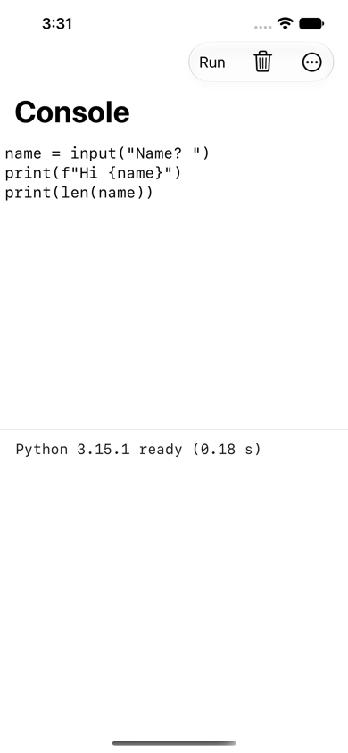 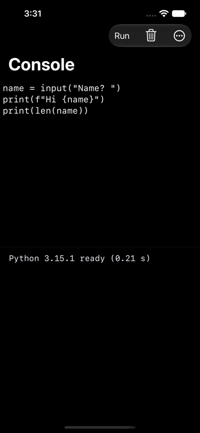</p>

What you can do: type or paste a script, press Run, and read the output. What happens behind it: the app starts Python inside itself, runs your text, and shows everything the script prints in the console as it happens. No server is involved.

After Run, the console shows what the script printed and a line saying how long it took ("Finished in ..."):

<p class="guide-shots">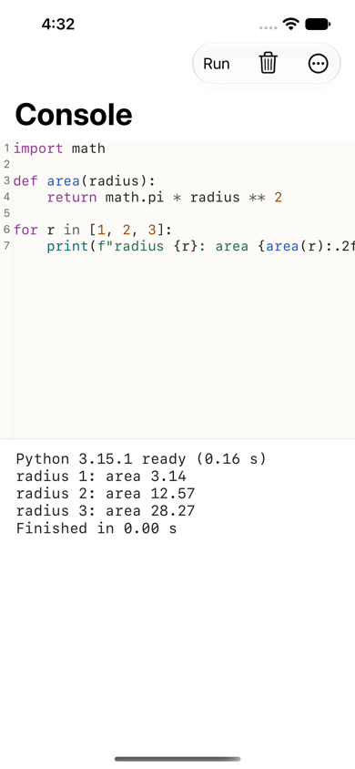 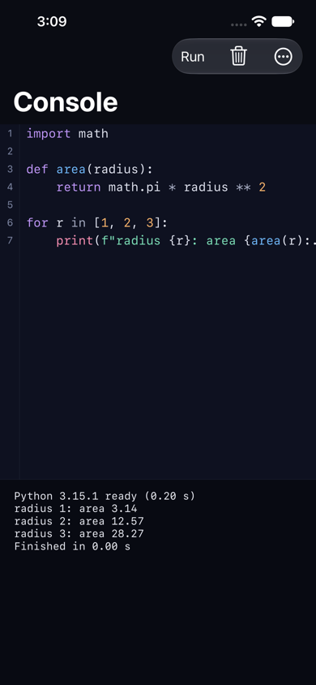</p>

A script can ask you a question (Python's command for this is `input()`). The console then shows a rounded answer box labelled "input()" with a send arrow, the keyboard rises, and the script waits for your answer. The button at the top now says Stop:

<p class="guide-shots">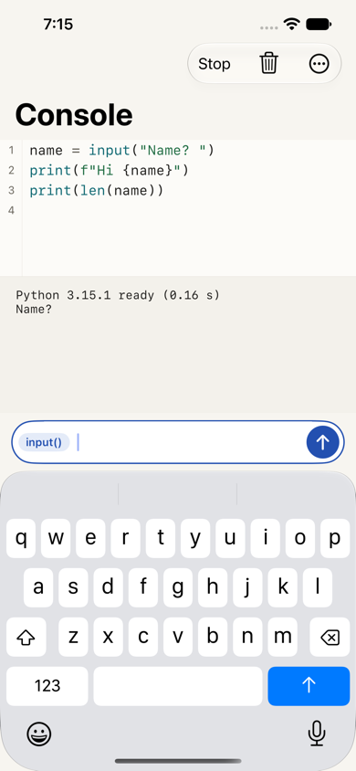 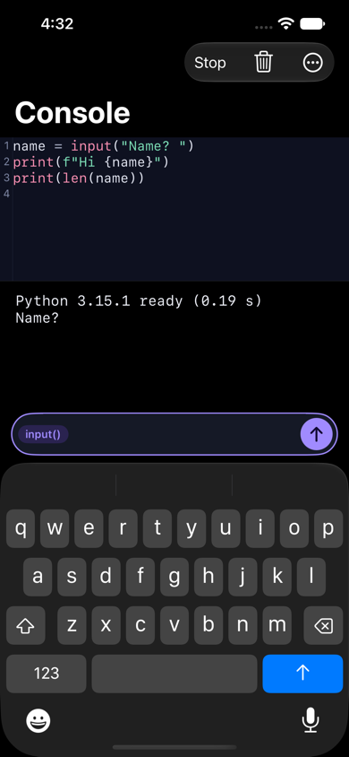</p>

Behind it: the script is paused, not stopped, until you reply. Stop ends the run at any time.

### 2.3 The editor

Since 28 October 2026 (task T-0565, commit 5ac90a05) the box you type in on the Console screen is the real code editor. It colours the script by meaning (reserved words, text in quotes, numbers), numbers the lines, and adds a row of extra keys above the keyboard on iPhone for characters that are hard to reach (tab, brackets, colon, equals, quote mark, undo, and a button to hide the keyboard). With a hardware keyboard attached, the extra row stays hidden. The first picture is the Console screen itself; the other two come from a separate test screen that <span title="What keeps an idea below the top: the cap that applies to it now.">holds</span> the same editor. The pictures were taken by an automatic test:

<p class="guide-shots">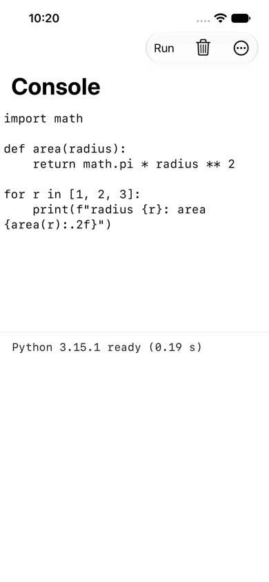 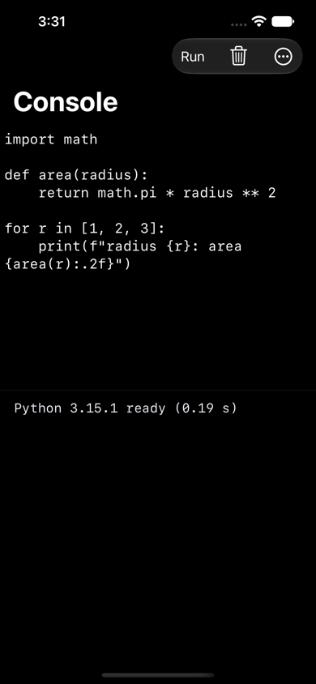</p>

<p class="guide-shots">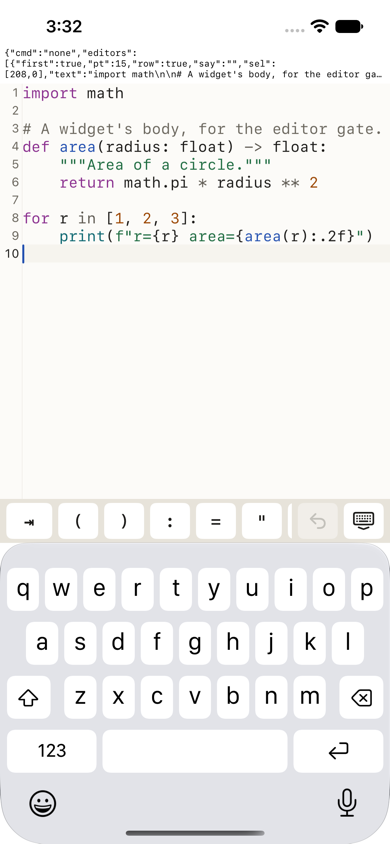 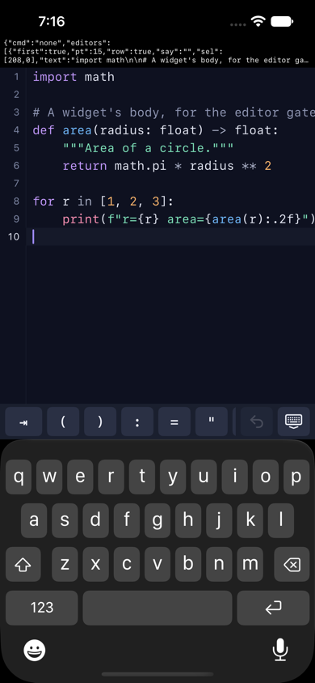</p>

Note: the small block of text above the code in the "editor-gate" pictures (the key-row ones, the picture above this note) is the test's own readout, not part of the app. The Console screen shows the same key row without it.

<p class="guide-shots">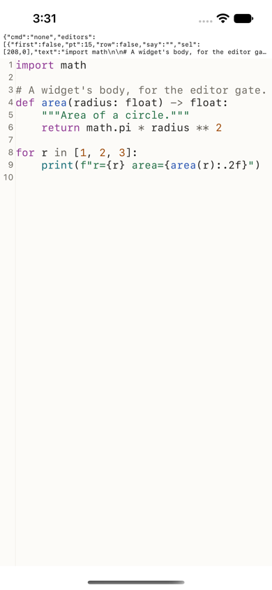 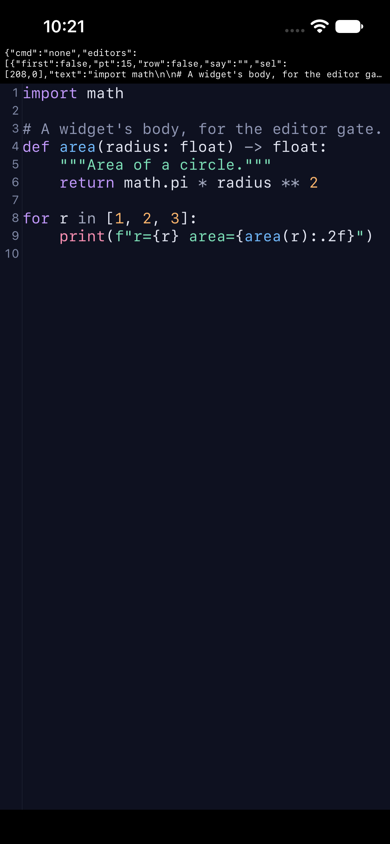</p>

Behind it: the editor is a ready-made open-source component (software others wrote and share freely) called Runestone, wrapped so the company can swap it if it fails its checks (ADR-004). It is accepted only when three checks pass: speed on a long file (measured once; a second measure after adjustments is pending, T-0460), use with VoiceOver (the iPhone's spoken screen reader) and with the user's chosen text size, and use with an iPad's attached keyboard. The last two are not yet done (T-0460, Day 10; device checks T-0479 need a real device). Not yet in the editor: completion suggestions, find and replace, several scripts open in tabs, and tapping an error to jump to its line (T-0389).

### 2.4 Ready-made example scripts

The app carries ten example scripts, for instance a tip splitter, a word counter, a unit converter and a password <span title="The starting recipe a lane uses to look for ideas. G2, for example, starts from public datasets.">generator</span>. One opens in the editor like any script (the picture shows the start of it; the box scrolls):

<p class="guide-shots">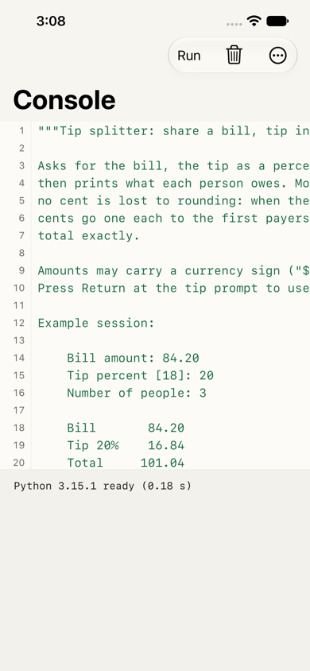 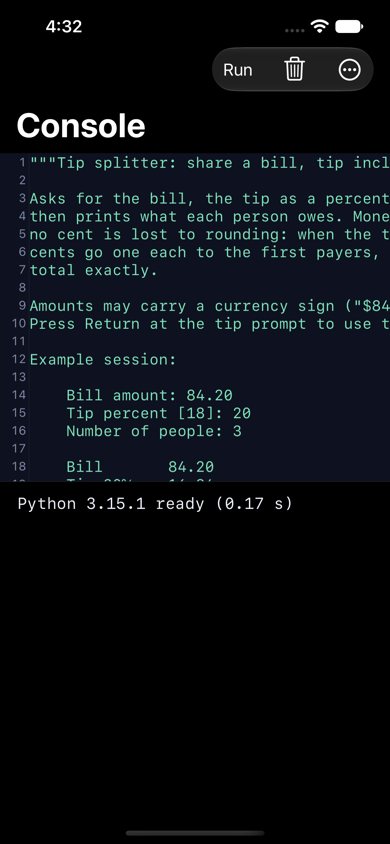</p>

Behind it: examples are ordinary text files that ship inside the app. You can edit and run them; nothing is downloaded. The tip splitter will be rewritten to use the app's own pop-up questions once those exist (T-0458, after T-0447).

### 2.5 The "more" menu

The button with three dots opens a menu: Restart (starts Python afresh), Copy All (copies the console text), then, below a line, Acknowledgements and pywidget Pro.

<p class="guide-shots">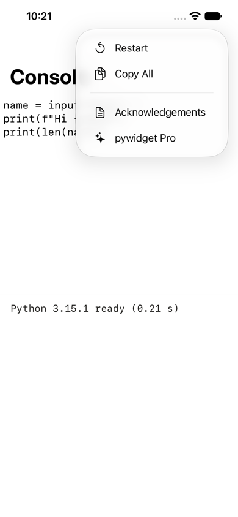 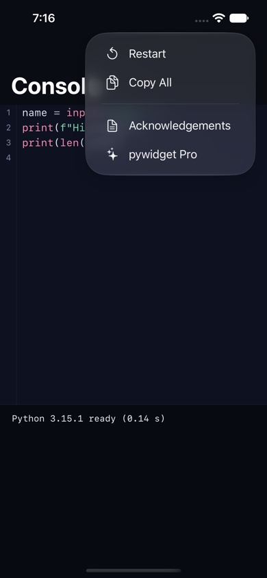</p>

This is a stopgap. The plan puts these in a Settings screen, which does not exist yet (section 5).

### 2.6 pywidget Pro

The Pro screen explains what the one purchase unlocks: the seven premade widgets that are not free (Habit tracker, Shortcuts launcher, Storage, Day progress, Quote of the day, World clocks, GitHub repository). A box says what stays free: running any Python, the editor and console, projects and files, Shortcuts actions, the device features, your own widgets and the five free premades. A blue button ("Unlock Pro") buys it; a link ("Restore purchase", for people who bought before on another device or after reinstalling) brings an earlier purchase back.

<p class="guide-shots">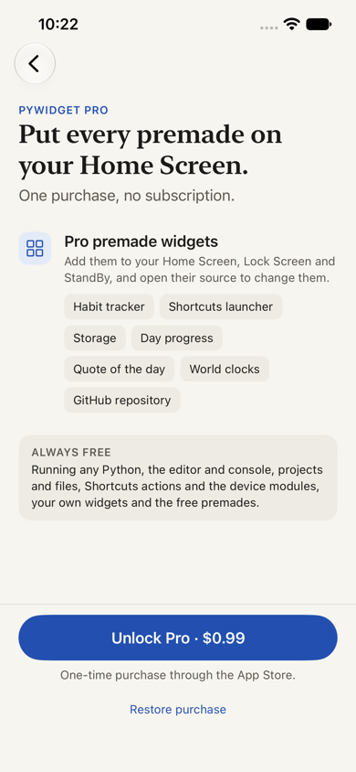 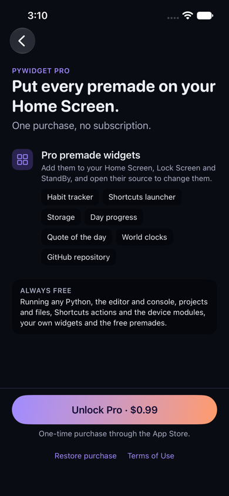</p>

After a purchase the screen says "Pro is active" with a green tick. Its line says the Pro premades are "open in the Gallery", and the Gallery does not exist yet (section 2.8). There is no button to it, because the app only shows that button where the Gallery can be reached:

<p class="guide-shots">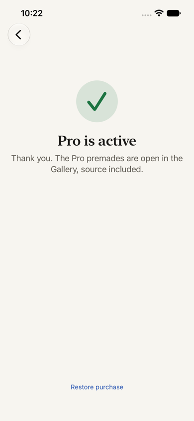 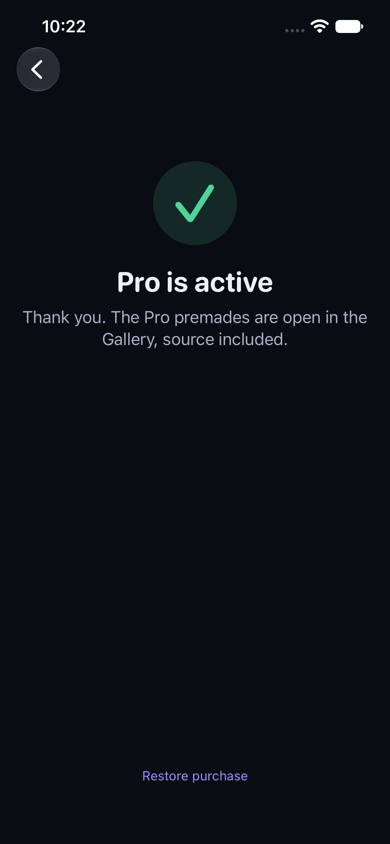</p>

Important: the price shown ($0.99) comes from a stand-in price list used only while testing and is not a proposal. The real price is the Investors' decision (PROPOSAL-001); an answer is needed by Day 12 (2026-11-02). Behind it: the app asks Apple's own purchase system, which charges you and tells the app the result; the app unlocks Pro only when Apple's reply checks out as genuine and the purchase has not been refunded. In this build, the purchase works only against the test file; the real store listing does not exist until the Investors' Apple accounts are ready (membership due Day 7, 2026-10-28; Paid Apps Agreement Day 12, 2026-11-02).

About the Pro words, and why they are not changed now. Every word on the Pro screen is a draft that still needs the Investors' approval (the screen's word file says so on its first line). The style guide approved the app's two looks, not the Pro screen beyond its shared colours and type, so the Pro screen's look and words go to the Investors as one request, with pictures, before anything is sent to Apple (task T-0625: Maren drafts, Ines posts). "Gallery" itself is not new: it is the name of the premade <span title="The App Store results a buyer sees for a search phrase. The top 10 is the first ten, dated the day we read them.">shelf</span> in the approved mockups, so using it needs no new approval. Renaming it would be a new decision and would go in that request. The two sentences that run ahead of the build:

- "The Pro premades are open in the Gallery" is true only once the Gallery is built (T-0191, Day 12). The alpha on Day 10 is an internal test build, so the line stays for it. If the Gallery is moved to version 1.1 at its check (freeze row F6, 2 November), the line changes to one that does not name it, before the freeze. That is task T-0624, for Maren and Idris.
- "Put every premade on your Home Screen" is true once a tap puts a widget on the Home Screen (T-0512) and Pro premades can be placed and locked again after a refund (T-0051). If Pro premades are cut from 1.0, the Pro screen drops this headline by itself, because it only shows the parts of Pro that the build switches on.

### 2.7 Acknowledgements

Open-source software the app is built on requires that its licence notices are shown. This screen lists them in two groups (Python itself, then add-on Python packages), and each opens as a page of licence text:

<p class="guide-shots">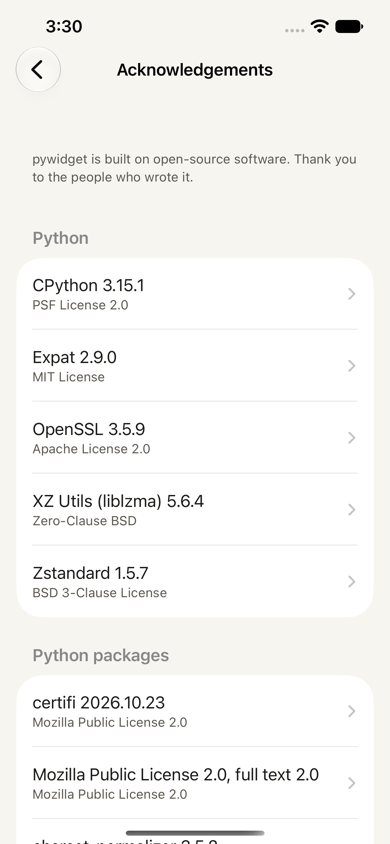 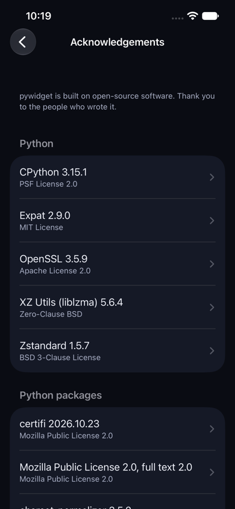</p>

<p class="guide-shots">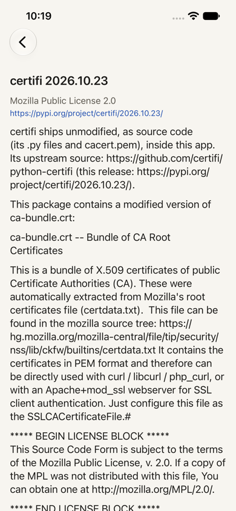 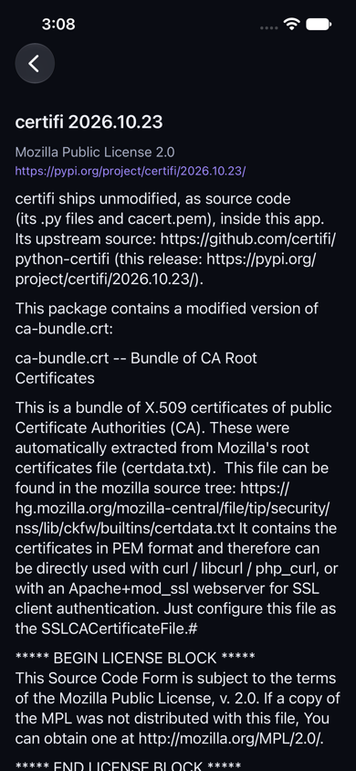</p>

One row reads "Mozilla Public License 2.0, full text 2.0". It is meant to be there; the wording is a small slip. certifi (the add-on that holds the list of trusted web certificates, used for secure web addresses) is shared under the Mozilla Public License 2.0, and that licence asks for its full text to travel with the app. certifi's own download carries only a short notice, so the company added the full text as its own entry, marked "part of certifi" (decision ADR-003, Odalys's list of 27 October). certifi's page shows that text too. The slip is in how the list prints a row: name, then version. For a licence the version is already in its name, so "2.0" appears twice, and the row looks like one more package. The fix: such a row drops the version and says "Part of certifi" underneath. It is task T-0623, for Idris, with Odalys checking that the record still matches; the licence duty is met either way.

Behind it: the list is produced automatically from the company's record of every outside piece, so a piece cannot ship without its notice. An automatic check by Odalys compares the two, and a build that fails the check is not sent anywhere (ADR-003, 2026-10-27 <span title="The worker who reads both graders and decides. The decision, a ruling, is one row in the rulings file.">ruling</span>).

### 2.8 Screens not built yet

These have no picture because the screens do not exist. Each is marked in section 5 with its task and date.

- **Projects and Files**: folders of scripts, scripts that import each other, import and export of .py files and zips, opening a folder from the Files app. Task T-0355.
- **The premade gallery**: a shelf of the 12 premade widgets with live previews, where the free ones can be added and Pro ones are previewed. T-0191.
- **Widget preview beside the editor**: runs the script you are writing as a widget in every size. T-0192.
- **Settings**: Acknowledgements, Pro and (only if the Investors approve) an editor theme picker will live here. Specified; T-0042 and T-0272.
- **Pop-up questions from scripts**: alerts, text and number questions, forms, lists, a short toast message. T-0447.
- **The full-screen run screen and Home Screen scripts**: turn a script into an icon on the Home Screen that runs it full screen. T-0449 (the design for it exists).
- **Placing a widget from a tap**: see section 5, task T-0512, the most urgent open task.

## 3. How it works underneath

### 3.1 The Python inside the app

The app carries a complete Python (version 3.15.1) taken from python.org, unmodified. Python runs in the app, not on a server, so scripts work without a connection. Apple does not let an app download code that changes how it works, so the scripts are your own and the pieces Python needs ship inside the app. A small fixed set of extra Python packages (add-on libraries of ready-made code) is bundled, and Python's built-in toolbox (its standard library) has a few unneeded parts cut out to save space (ADR-003).

### 3.2 From a script to a Home Screen widget

Today's design, and the fallback if the widget-part Python <span title="One numbered piece of research into one area of ideas. Each lane has its own file.">lane</span> fails its phone tests (section 4.1): a widget cannot run Python itself, because Apple gives the widget part of an app only a small amount of working memory and a short time. So the work is split (ADR-007, option b):

1. The app runs your script. The script describes the widget as a short plain-text description of a picture: which text, which colours, which sizes. This description is called a view tree (a list of the pieces of the widget picture, ADR-002).
2. The app saves that description in a folder the app and its widget part share.
3. The widget part reads the description and draws it with Apple's own screen-drawing software. It never runs your Python.

Benefits: the widget works with light and dark mode, large text and the Lock Screen styles for free, and old widgets keep drawing after the app updates. Cost: the widget is only as fresh as the last time the app ran the script (section 4.1).

### 3.3 Device features

Scripts can use these (ADR-001, "device modules"). Location, steps and notifications ask the person's permission through Apple's standard prompt the first time they are used; the app's explanatory sentences are written already.

- **Location**, only while the app is in use. Text shown: your scripts and widgets read your location only when they ask for it; the app keeps the last reading on the device and never sends it anywhere.
- **Steps, floors and distance** from the phone's motion sensors, for the last seven days. Same promise.
- **Notifications**, local ones the script schedules. The prompt is not drawn in any picture yet because no screen asks for it.
- **Clipboard**: iOS itself may ask before a script reads text copied in another app. **Files**: only places you pick. **Keychain**, the phone's locked store for passwords and keys, for example a service password a script needs.
- **Network**: a script may fetch from the internet if you write it to. The app itself has no account and no analytics.

None of the sensors work inside the widget; they run in the app, which then saves the answer for the widget. Not in version 1: health data, contacts, photos, calendar, reminders (each needs its own permission and review).

### 3.4 Where files are kept

Scripts and widget data stay on the device. The app's own folder holds your scripts and projects. A second folder, shared between the app and its widget part, holds each widget's drawing, a small note on how its last run went, and a 14-day log of runs (ADR-007). You can export a script as a .py file or a zip. Nothing is uploaded and there is no cloud copy unless you put a folder in iCloud Drive yourself (that option, "open in place", is part of task T-0355 and may move to 1.1).

### 3.5 What Pro unlocks and how buying works

Pro is one non-consumable purchase (bought once, not renewed), no subscription. Today it unlocks seven premade widgets; five are free. Pro may also carry editor themes or native packages if the Investors approve them and they pass their checks; the build settings say both are off today. The Pro contents are fixed in the build before it is sent to Apple and are shown in the app; there is no hidden switch that changes what Pro unlocks after release (ADR-001; Apple's App Review rule 2.5.19). Apple handles the payment; the company never sees card details.

### 3.6 What works with no connection

Running scripts, the editor, the examples, the Pro screen's wording, Acknowledgements, and every widget drawing from the last run all work offline. Scripts that fetch from the web, and the GitHub repository premade, need a connection. Buying or restoring Pro needs one.

## 4. Limits and the decisions behind them

Each limit has the record it comes from. Records are in pywidget/docs/decisions/ (Documents > Pywidget > Build Plan > Decisions).


<div class="tbl" role="region" tabindex="0" aria-label="Table 1: 4. Limits and the decisions behind them, scrolls sideways" style="--tw:960px" markdown="1">

| Limit | Why | Record |
| --- | --- | --- |
| Version 1 is the editor plus a narrow widget engine plus 12 premades. The full brief (web editor, block builder, marketplace and more) is several products. | One engineer and one test slot at a time. A first review of a code-running app is careful and one rejection costs about a week. | ADR-001 |
| Widget cut line, Day 14 (2026-11-04): widgets ship in 1.0 only if 8 of 12 premades draw correctly in every size and mode, a user-written widget reaches the Home Screen, and the design checks pass. Otherwise 1.0 is the editor only. | Decided in advance so the call is not made under pressure. If cut, Pro has little to sell, which is why the pricing proposal exists. | ADR-001, section 3.3 |
| Home Screen widgets are not live. Apple decides refreshes, and the best any app can do without a server is every 15 to 60 minutes. Until Python in the widget part is proved on a phone, they show what the app last drew. Apple's budget is about 40 to 70 a day for a widget you look at often, roughly every 15 to 60 minutes, fewer if you rarely look. | Apple's published budget, in Apple's own words on its current developer page "Keeping a widget up to date" (read signed out on 26 October 2026 under the Investors' ruling of that day; the saved copy is in research/inbound/apple/). The page does not tie the figure to an iOS version; it is the page Apple publishes now, and Apple calls it typical, not a promise. The company's team believes test tools on the Mac <span title="A new, permitted reading that removes a cap. A lift rule is that reading, written down before we look.">lift</span> the limit, but that sentence is not on Apple's page, so it is a belief, not a fact; only a real phone gives real numbers. | ADR-007; research note L2; App Review notes, item A3 |
| Python in the widget part is built for version 1.0 but ships switched on only if it passes tests on a real iPhone. Until then, and if it fails, the widget part never runs Python. | Apple publishes no memory or time limit for the widget part. The figure of about 30 MB is widely reported but not confirmed by Apple or by us. A script that goes over is simply stopped, with no error anyone can see. The switch is set from real-phone numbers before the release candidate, never from the Simulator (the Mac's phone stand-in). Only light scripts run there: a short list of Python modules (dates, maths, JSON, text) is checked when a script is saved and again when it runs. | ADR-007, chair line 2026-10-29 08:03 |
| No buttons or toggles inside widgets in the first release; widgets are static pictures that update over time. | Cut to 1.1 to protect the date (the description format already reserves room for them). | ADR-001 section 3.2; ADR-002 |
| A fixed set of bundled packages in version 1. No online installs and no browsing for packages. Install from a file is a stretch goal that lands by Day 13 or moves to 1.1. | Apple's rules on downloading code carry review risk; the bundled set is checked for licence and size. Compiled add-ons such as NumPy or Pillow ship only if they work on a phone by Day 10. | ADR-003; ADR-006 |
| No marketplace, gallery of other people's code, or sharing in the app. The 12 premades are inside the app; any script exports as a readable file. | Apple's rule on apps that run code from other people is unclear and risky. A web gallery comes after approval, an in-app one much later. | ADR-006 |
| Location only while the app is open; a distance widget may show an old reading, and says when it was taken. | Asking for "always" location in a first review would raise the risk. | ADR-001 (revised table) |
| No compatibility layer for another app's scripts. | Needs a legal review and a ruling on collecting public scripts, held until the Investors answer. | ADR-005 |
| Not in 1.0 (moved to 1.1 or later): debugger, code formatter, share-sheet "Run Python on this", interactive widgets, health/contacts/photos/calendar, Install from file if late, block builder, web editor, marketplace, Watch, Mac. | Each adds work, permissions or review risk. | ADR-001 section 3.2 |
| The editor is accepted only after its three checks. If they fail, a plainer editor replaces it. | Speed, screen-reader and iPad use must pass first. | ADR-004 |
| No account, no server, no analytics. Pro's contents and price are the Investors' call. | Keeps the privacy story simple and the review easy; Investor rule. | ADR-001; PROPOSAL-001 |

</div>


### 4.1 Widget freshness: the options and their limits

The Investors asked on 29 October 2026 (issue #41) for the freshest widget possible, delay accepted. The ruling is recorded in ADR-007 (chair line of 2026-10-29 08:03). For a Home Screen widget, "every 15 to 60 minutes" is the best any app can do without a server; nothing in iOS 26 or 27 lifts it. This guide does not call options A or B "live". Seconds-level content exists only as timers (time-derived text and bars) and Live Activities (Lock Screen and Dynamic Island). Where a number comes from the Simulator or a widely reported figure rather than a real iPhone, it is marked. The memory ceiling is unconfirmed until a real iPhone is tested (issue #100, signing).


<div class="tbl" role="region" tabindex="0" aria-label="Table 2: 4.1 Widget freshness: the options and their limits, scrolls sideways" style="--tw:1792px" markdown="1">

| Option | What it does | What it can't do | Limits to know | Needs the app running? | Delay to launch |
|---|---|---|---|---|---|
| **A. Python in the widget part** (ruled: built for 1.0, switched on by device tests) | Reruns the script every 15 to 60 minutes, whenever iOS wakes the widget, and on a Refresh tap; any logic, any JSON feed | Go faster than Apple's budget; use heavy Python modules; survive a memory overrun (it falls back to the last picture with a badge) | 15 to 60 minutes, 40 to 70 a day; the script gets 2 seconds; memory ceiling unconfirmed until #100; the first device test is whether the widget part can even load Python under a real signature | No | +8 days (submission Day 17 to Day 25, 2026-11-15), plus day-for-day if #100 lands after Day 21 |
| **B. Declared Swift steps** (building blocks in 1.0; "bound fields" only if A fails) | On every wake-up, fetches one URL and shows named fields, reads today's steps, takes a location fix; no Python | Compute anything (a feed that needs more than "this field" is A's); change colours or layout by rules | Same 15 to 60 minute budget; steps need a device check (T-0011); only declared fields are fresh | No | +3 days on top of A if needed (Day 28, 2026-11-18); alone it would have been about +5 (Day 22) |
| **Timers in the view** (shipped) | Clocks, countdowns, "updated 4 min ago", progress bars that move by themselves, to the second | Show anything that isn't a function of time | None | No | 0 |
| **Shortcuts automation** (shipped) | Runs every widget's script fresh at times or events you pick ("7:00", "when I arrive") | Run without a one-time 2 to 3 minute setup | iOS launches the app briefly in the background | Briefly, launched by iOS | 0 |
| **iOS background refresh** (shipped) | Lets iOS run the app briefly when it chooses | Promise a cadence; often hours | Real cadence only measurable on a phone | Briefly, launched by iOS | 0 |
| **Live Activity, updated by the app** (1.1) | A journey or a run on the Lock Screen and Dynamic Island, updated for minutes at a time while the app works in the background, up to 8 hours | Sit on the Home Screen; last past 12 hours | 4 KB of data; no network inside the activity itself | Yes, intermittently | 0 to 1.0 (3 to 4 days in 1.1) |
| **Server push** (WidgetKit push, pushed Live Activities) | Event-driven updates | Beat the budget (Apple calls widget push "opportunistic") | Needs a server and Apple push keys: the Investors' spend and sign-up | No | Not planned; needs an Investor decision on a server first |
| **Keeping the app alive** (audio, decoy activity) | - | - | Breaks App Review rule 2.5.4 | - | Never |

</div>


If option A fails its device tests, the code stays dormant and the widget is as fresh as the last app run, with a badge. If the Investors' signing step (#100) lands after Day 21, the release candidate waits for it day for day. One consequence: version 1.0 would be on sale around Day 27 to 28 at best, so the $200-by-Day-30 line can be measured over only two or three selling days.

### 4.2 Four examples under the ruling


<div class="tbl" role="region" tabindex="0" aria-label="Table 3: 4.2 Four examples under the ruling, scrolls sideways" style="--tw:1243px" markdown="1">

| Widget | A switched on (passes device tests) | A off (fails them), with bound fields | Today's design |
|---|---|---|---|
| **Time** (clock, countdown, day progress) | Live, to the second, no budget used | Same | Same |
| **Transit, timetable** | One run plans the day; each departure counts down live; the plan refetches itself every 15 to 60 minutes | Same picture; the table refreshes only when the app runs | Same, table from the last app run |
| **Transit, real-time delays** | New data every 15 to 60 minutes and on a Refresh tap, no app; any feed, parsed in Python | New data every 15 to 60 minutes and on a tap, but only for feeds where the value is a named JSON field | Delay as of the last app run, with "updated N min ago" |
| **Steps** | Today's count every 15 to 60 minutes and on a tap, plus goal percentage or pace; needs the device check (T-0011) | Today's count every 15 to 60 minutes; the same device check | Count from the last app run |

</div>


The seconds-level version of "transit" (a bus arriving) is a Live Activity in 1.1, on the Lock Screen, for the hour of the journey.

## 5. Being built now

Status is taken from the task board on 2026-10-28. "Alpha" is Day 10 (2026-10-31); "freeze" is Day 13 (2026-11-03); "submit" is Day 17 (2026-11-07).


<div class="tbl" role="region" tabindex="0" aria-label="Table 4: 5. Being built now, scrolls sideways" style="--tw:989px" markdown="1">

| What | What is missing | Task | Date |
| --- | --- | --- | --- |
| A tap puts a widget on the Home Screen | Today only test code writes a widget's drawing; neither a premade nor your own script reaches the Home Screen from a tap. The most urgent gap. | T-0512 (P0) | Alpha check |
| Premade widgets | Code exists; 6 are due for the alpha, 12 by Day 12. Their pictures come from a test that is still being corrected. | T-0191, T-0511 | Day 10 to Day 12 (2026-11-02) |
| Premade gallery | Not built | T-0191 | Day 12 |
| Widget preview beside the editor | Not built | T-0192 | Day 12 |
| Projects and Files | Not built; floor: container projects and .py import and export, "open in place" to 1.1 if late | T-0355 | Freeze (Day 13) |
| Pro placement and refund handling | Free users must not see Pro widgets placed; refunds must lock them again | T-0051 | Freeze |
| Pop-up questions from scripts | The screen half (alerts, forms, lists, toast) is not built; the Python half is a separate task (T-0446) | T-0447 | Day 12 |
| Home Screen scripts and the full-screen run screen | Designed (design notes for the run screen and the setup walkthrough); the app half is not built. Copy is a draft until one hand-run test | T-0449 | Freeze |
| Settings, with Acknowledgements and Pro moved in | Not built; the "more" menu stands in | T-0042 | Day 14 to 15 |
| Editor: screen-reader, text-size and iPad checks | Not run | T-0460, T-0479 | Day 10; real device later |
| Editor: tappable error lines | Not built | T-0389 | Not dated |
| Shortcuts actions (Run Script) | Refresh Widgets works; Run Script was a stub and was wired for the alpha check A10; follow-ups open | T-0510 | Alpha |
| Editor themes in Pro | Waiting for the Investors' approval of a design (<span title="Commandment 51: the Investors approve every visual before it ships.">C51</span>) | T-0272 | Day 12 |
| First-run tour | Not built | T-0193 | Day 12 |
| App-rating request after a real success | Rule written; screen not built | T-0273, T-0346 | Not dated |
| Install from a file | Stretch goal; 1.1 if not done | T-0212 | Day 13 |
| Pictures not yet taken | iPad two-window view, premade widgets on the Home Screen, permission prompts, and every screen above | T-0556 | Not dated |
| Pricing answer from the Investors | Needed to set Pro's real price | PROPOSAL-001 | Day 12 |
| Verdict on the alpha | A written pass or fail per check | T-0361 | 2026-10-31, 23:59 |
| Feature freeze | After this only fixes | | Day 13 (2026-11-03) |
| Widget cut line | The call on whether widgets ship in 1.0 | | Day 14 (2026-11-04) |
| Icon, screenshots, store page (need the Investors' approval) | Not part of this guide | | Day 15 (2026-11-05) |
| Submission to Apple (needs the Investors' approval) | | | Day 17 (2026-11-07) |

</div>


## 6. Design choices

Every look-and-feel decision made for the app, with the pictures that exist for it. Each is marked **approved** (an Investor said yes in writing; the words and the link are in `creative/approved.md`) or **pending** (shown to the Investors, no answer yet, so nothing here is decided). These pictures are drawings made by the company's own scripts from the colours and type in the design files, not photos of the running app, and no image-making AI was used (Commandment 9). The screens in section 2 are the real app; these show what was proposed or approved. This section is the one place that lists them, and it is updated as decisions land.

### Approved

**6.1 Light and dark look: "Paper" and "Studio" (issue #60). Approved 2026-10-25.** The app has two looks and follows the phone's Light/Dark setting: Paper (light, a serif heading face) and Studio (dark, a rounded heading face). There is no in-app switch. Pictures: the Console in light and dark.

<p class="guide-shots">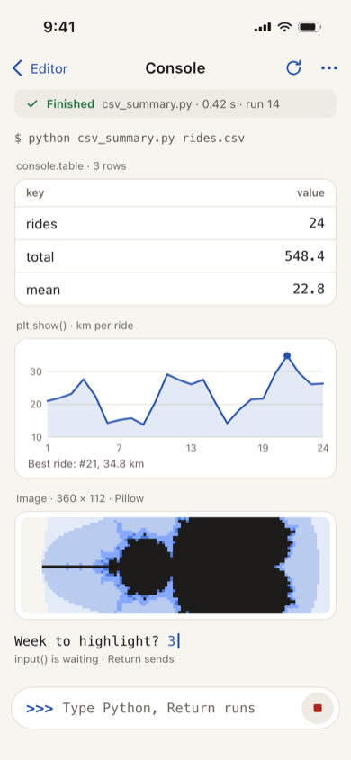 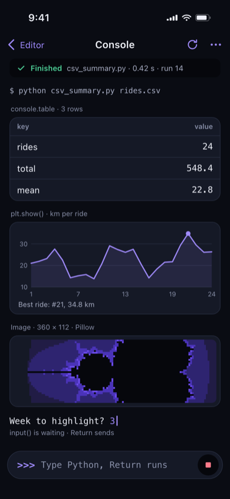</p>

**6.2 The Pro purchase screen: its look and words (issue #94). Approved 2026-10-28.** The screen that offers pywidget Pro, and the small entry points to it. The price and what Pro contains are not part of this approval (issue #87 decides those).

<p class="guide-shots">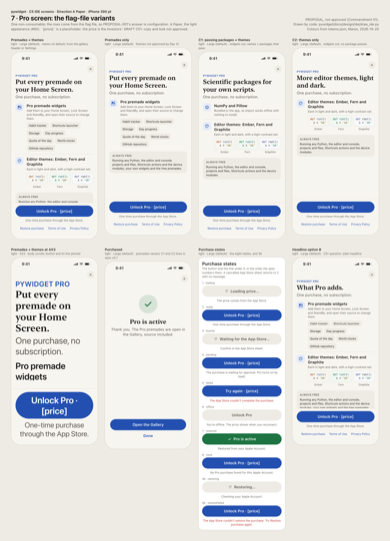 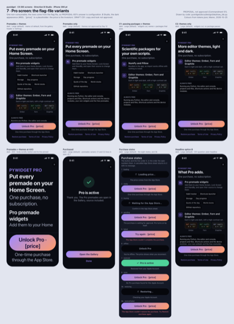</p>
<p class="guide-shots">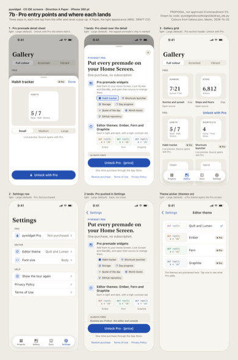 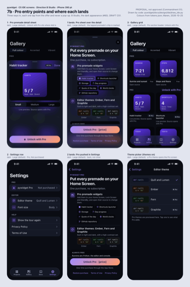</p>

**6.3 Colour of search matches in the code editor (issue #95). Approved 2026-10-28.** Every match gets a pale amber tint; the current match keeps the selection colour. One picture, with the options that were compared.

<p class="guide-shots">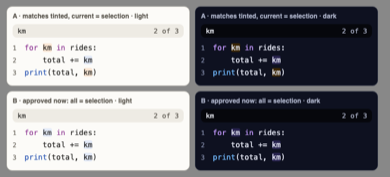</p>

**6.4 Three extra editor colour themes: Ember, Fern, Graphite (issue #93). Approved 2026-10-28.** Each comes as a light and a dark pair. Whether they are free or part of Pro is not decided here (issue #87).

<p class="guide-shots">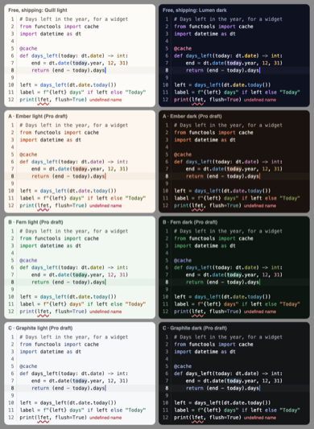</p>

**6.5 The website's chat page and Now panel (issue #29). Approved 2026-10-25.** This is the company's website, not the app, so no picture is repeated here; the approval record is in `creative/approved.md`.

### Pending: waiting for the Investors

**6.6 The app icon (issue #92, open, answer wanted by 2026-11-02).** Three directions, each in light, dark and tinted: Indent (the company's recommendation), Prompt and Trace. Nothing is decided, and the icon in test builds is a plain placeholder. How each one is built from numbers and formulas is in section 7. Shown at their real small size (60 pixels), top row Indent, then Prompt, then Trace; each row is light, dark, tinted.

<p class="guide-shots">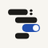 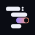 </p>
<p class="guide-shots"> 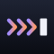 </p>
<p class="guide-shots">  </p>

**6.7 The App Store screenshots (issue #92, open, same card).** Two layouts are proposed, "Open" (recommended) and "Framed". Gap: the contact sheets for both layouts are not in the main branch of the repository (they are on a separate preview branch, drawn before the card's last changes), so there is no picture here. The real screenshots are taken from the running app after the code freeze on Day 13 (2026-11-03) and shown to the Investors on Day 15 (2026-11-05).

**6.8 The app's public name (issue #90, open, answer wanted by 2026-11-02).** Three coined names are on the card (Coilwork is recommended). Gap: there is no picture of the three names. The only picture that exists is of how the placeholder name "pywidget" or "PyWidget" would be written under the icon and in copy (option E on the card).

<p class="guide-shots">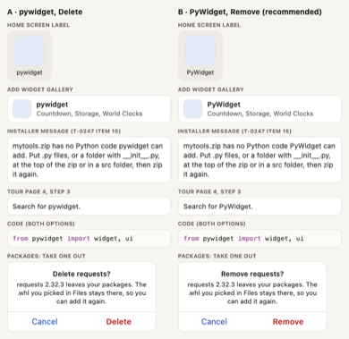</p>

**6.9 Other screens drawn but not yet built or not separately approved.** These are drawings of the home, run, settings and gallery screens and of the Home Screen widget states. They are drawn from the approved colours of 6.1, but no Investor decision on them is recorded, so they are shown as pending and nothing in them is final. The real versions, where built, are in section 2.

<p class="guide-shots">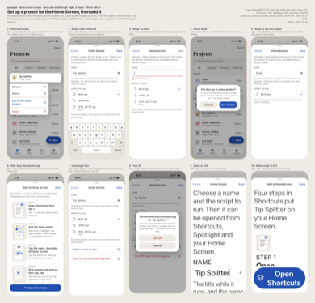 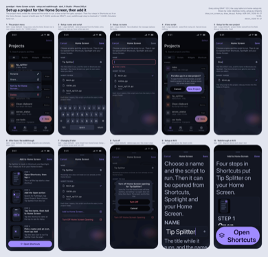</p>
<p class="guide-shots">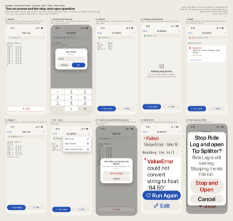 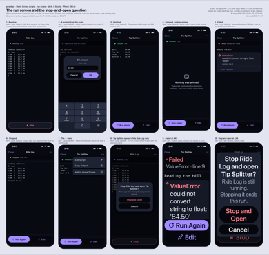</p>
<p class="guide-shots">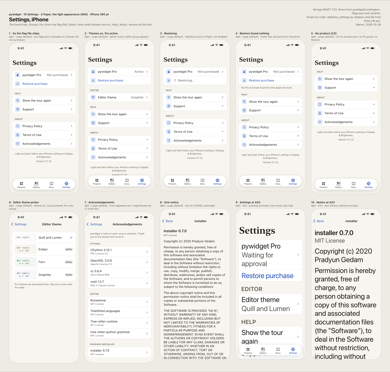 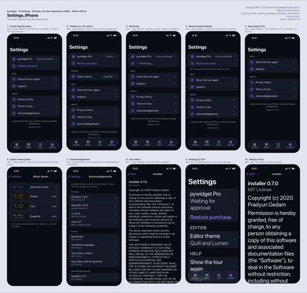</p>
<p class="guide-shots">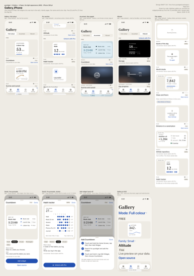 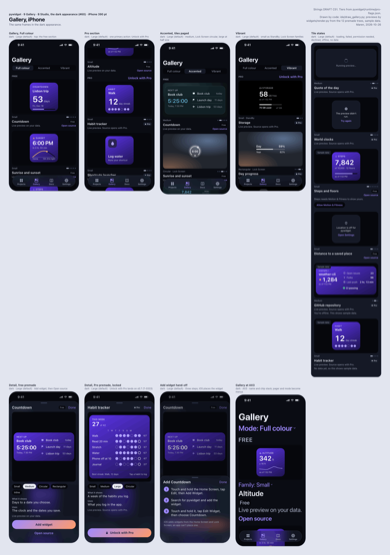</p>
<p class="guide-shots">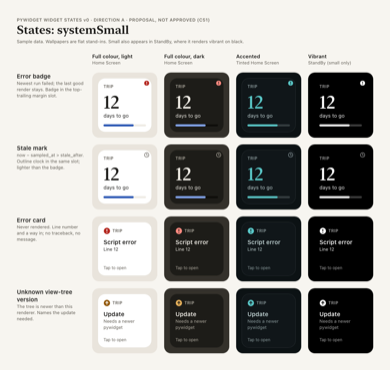</p>

Not design choices and so not listed: the price and Pro contents (issue #87) and the privacy policy facts (issue #98) have no pictures.

## 7. How the pictures are made in code

Investor question (issue #41, an Investor): how mathematics is used to create each designed icon, with the exact functions, and a picture of how every element is used. This section answers it. It describes what the code does as written on 29 October 2026 (Commandment 33), and every picture here comes from a script you can read and run (Commandment 9). No image-making AI, stock art, font glyph or photo is in any of them. The three icon options are **options only**. Nothing here says which one is chosen: that is the Investors' call on issue #92 (Commandment 51).

Scripts, all in `pywidget/docs/design/icon/` and run from any folder:

- `draw_icons.py OUTDIR` makes the icons themselves (the file the question is about).
- `draw_construction.py` makes the construction strips and the colour sheet below. It calls the same `indent()`, `prompt()` and `trace()` functions as the icons and draws the shapes they return, so a strip cannot disagree with an icon. It also checks its own copies of the Trace numbers against the icon's.
- `draw_portrait_families.py` makes the portrait picture in 7.5.

### 7.1 The ground rules, before any icon

**The page is a square of numbers.** An icon is a list of shapes, each described by plain numbers on a square sheet 1024 units wide and 1024 tall (the App Store size is 1024 pixels, so one unit is one pixel there). The point (0, 0) is the top-left corner and **y grows downward**, as on every screen. The middle is (512, 512). The code that writes this is `svg()` in `draw_icons.py`: it puts a background rectangle and then the shapes in a file format called SVG, a text file of shapes. A headless copy of the Chromium browser then turns the text into pixels; it only paints, it does not invent anything.

**Two guard rails, both measured from the shapes.** The *mask* is the rounded corner iOS cuts every icon with; the code stands in for Apple's curve with a rounded square whose corner radius is 0.2237 x 1024 = 229 units. The *safe area* is a margin of 96 units: every corner of the drawing must sit at least 96 units inside the mask. `qa_for()` checks this for each file, and the result today is 0 faults.

**Five small tools build every shape.** Each one writes one SVG shape and also reports the box it covers (used for the checks).

```python
def bar(x0, x1, yc, h, fill):
    return {"svg": f'<rect x="{x0}" y="{yc-h/2}" width="{x1-x0}" height="{h}" rx="{h/2}" fill="{fill}"/>',
            "bbox": (x0, yc - h / 2, x1, yc + h / 2), "min": h, "fill": fill}


def dot(cx, cy, r, fill):
    return {"svg": f'<circle cx="{cx}" cy="{cy}" r="{r}" fill="{fill}"/>',
            "bbox": (cx - r, cy - r, cx + r, cy + r), "min": 2 * r, "fill": fill}


def rect(x, y, w, h, rx, fill):
    return {"svg": f'<rect x="{x}" y="{y}" width="{w}" height="{h}" rx="{rx}" fill="{fill}"/>',
            "bbox": (x, y, x + w, y + h), "min": min(w, h), "fill": fill}


def stroke_path(pts, width, stroke, closed=False, fill_for_qa=None):
    d = "M" + " L".join(f"{x:.1f},{y:.1f}" for x, y in pts) + (" Z" if closed else "")
    xs, ys = [p[0] for p in pts], [p[1] for p in pts]
    w2 = width / 2
    return {"svg": f'<path d="{d}" fill="none" stroke="{stroke}" stroke-width="{width}" '
                   f'stroke-linecap="round" stroke-linejoin="round"/>',
            "bbox": (min(xs) - w2, min(ys) - w2, max(xs) + w2, max(ys) + w2), "min": width,
            "fill": fill_for_qa or stroke}


def lin_grad(gid, c0, c1, x1="0", y1="0", x2="1", y2="1"):
    return (f'<linearGradient id="{gid}" x1="{x1}" y1="{y1}" x2="{x2}" y2="{y2}">'
            f'<stop offset="0" stop-color="{c0}"/><stop offset="1" stop-color="{c1}"/></linearGradient>')
```

Plain English:

- `bar(x0, x1, yc, h, fill)` is a pill: it runs from x0 to x1, is centred on height `yc`, is `h` tall, and its corner radius `rx = h/2` is half its height, so both ends are perfect half-circles.
- `dot(cx, cy, r, fill)` is a circle with centre (cx, cy) and radius r.
- `rect(...)` is a rectangle with rounded corners of radius `rx`.
- `stroke_path(pts, width, ...)` is a line drawn through a list of points with a pen of the given width; round ends and round joins. Its box is the points' box widened by half the pen width on every side.
- `lin_grad(...)` is a blend between two colours. The four numbers are where the blend starts and ends as fractions of the shape's own box: (0, 0) to (1, 0) is left to right, (0, 0) to (0, 1) is top to bottom, (0, 0) to (1, 1) is corner to corner.

**Where the colours come from.** Nothing is picked by eye in the icon file. `TOK` reads `design/tokens.json`, the same colour file the app uses. The *light* icon takes its colours from palette A "Paper", the *dark* icon from palette B "Studio" (the pair approved in issue #60). The *tinted* icon is different: since iOS 18 the system asks for a grey picture and paints it in the user's chosen tint, brightest grey meaning most important. So the code uses three fixed greys: white `#FFFFFF`, mid grey `#9E9E9E`, black `#000000`. The sheet shows every colour, its role and where it comes from.

<p class="guide-shots">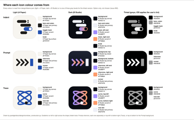</p>

**How contrast is checked.** Each icon colour pair (mark against its background) must reach at least 3 to 1, the usual minimum for graphics that are not text. The code does it with two functions:

```python
def lum(hexc):
    h = hexc.lstrip("#")
    c = [int(h[i:i + 2], 16) / 255 for i in (0, 2, 4)]
    c = [v / 12.92 if v <= 0.04045 else ((v + 0.055) / 1.055) ** 2.4 for v in c]
    return 0.2126 * c[0] + 0.7152 * c[1] + 0.0722 * c[2]


def ratio(a, b):
    la, lb = sorted((lum(a), lum(b)), reverse=True)
    return round((la + 0.05) / (lb + 0.05), 2)
```

In words: each colour channel (red, green, blue) is first written as a number from 0 to 1, then the screen's brightness curve ("gamma") is undone: values at or below 0.04045 are divided by 12.92, larger ones become `((v + 0.055) / 1.055)` raised to the power 2.4. The three results are added in the proportions 0.2126, 0.7152 and 0.0722, because the eye is most sensitive to green. That sum is the colour's *relative luminance* L, from 0 (black) to 1 (white). The *contrast ratio* is `(L_lighter + 0.05) / (L_darker + 0.05)`, so black on white is 21 to 1 and identical colours are 1 to 1. Lowest ratio per icon in `qa.json`: Indent 6.77 (light), 7.10 (dark), 7.84 (tinted); Prompt 6.77, 5.68, 7.84; Trace 6.77, 7.10, 7.84. Where a colour is a blend, both ends are checked.

### 7.2 Option 1, Indent (the company's recommendation)

**The idea.** Four lines of code drawn as bars: a line that ends in a colon, a line pushed in, a deeper line that is a live switch, and a line pulled back out. Python is read by its indentation, so the shape of the code is the picture.

**The exact function** (`indent(app)`, comments as written):

```python
# ------------------------------------------------------------ direction 1: Indent
# A block of code read as shapes: a line ending in a colon, an indented line,
# a deeper line that is a live toggle, a dedent. Python's structure is its
# indentation; the innermost line is the thing you can tap on the Home Screen.
def indent(app):
    defs, acc_stops = "", None
    if app == "light":      # A Paper: ink bars on paper, the ink-blue toggle
        bg, ink, acc, knob = A_L["bg.canvas"], A_L["text.primary"], A_L["accent"], A_L["bg.surface"]
    elif app == "dark":     # B Studio: pale bars on night, the violet-to-coral toggle
        defs = lin_grad("t", B_D["accent"], B_D["accent.2"], "0", "0", "1", "0")
        bg, ink, acc, knob = B_D["bg.canvas"], B_D["text.primary"], "url(#t)", B_D["bg.canvas"]
        acc_stops = (B_D["accent"], B_D["accent.2"])
    else:
        bg, ink, acc, knob = T_BG, T_MID, T_HI, T_BG
    H, step, ind, th = 124, 168, 150, 172          # bar height, line pitch, indent, toggle height
    x0 = 512 - (2 * ind + 380) / 2                    # centre the widest line (the toggle row)
    ys = [512 - 1.5 * step, 512 - 0.5 * step, 512 + 0.5 * step, 512 + 1.5 * step]
    els = [
        bar(x0, x0 + 420, ys[0], H, ink),
        dot(x0 + 492, ys[0] - 36, 29, ink),        # colon: two dots
        dot(x0 + 492, ys[0] + 36, 29, ink),
        bar(x0 + ind, x0 + ind + 470, ys[1], H, ink),
        dict(bar(x0 + 2 * ind, x0 + 2 * ind + 380, ys[2], th, acc), fill=(acc_stops or [acc])[0]),  # toggle track
        dot(x0 + 2 * ind + 380 - th / 2, ys[2], th / 2 - 22, knob),   # toggle knob (on)
        bar(x0 + ind, x0 + ind + 300, ys[3], H, ink),
    ]
    stops = acc_stops or (acc,)
    pairs = [("ink", ink, bg)] + [("toggle " + c, c, bg) for c in stops] + [("knob on " + c, knob, c) for c in stops]
    return {"bg": bg, "defs": defs, "bg_fill": bg, "els": els, "pairs": pairs}
```

**The math, step by step.**

1. **Constants.** `H = 124` (bar height), `step = 168` (distance from one line to the next), `ind = 150` (how far each indent moves right), `th = 172` (toggle height).
2. **Rows.** The four row heights are `512 - 1.5 x 168`, `512 - 0.5 x 168`, `512 + 0.5 x 168`, `512 + 1.5 x 168` = 260, 428, 596, 764. The multipliers -1.5, -0.5, +0.5, +1.5 are symmetrical around zero, so the block is centred top to bottom by construction.
3. **Left edge.** `x0 = 512 - (2 x 150 + 380) / 2 = 172`. The widest line is the toggle row, which starts two indents in (300) and is 380 wide, so 680 units; half of that on each side of 512 gives the left edge 172 and the right edge 852.
4. **The lines.** Line 1 runs from 172, 420 wide. Line 2 starts one indent in (172 + 150 = 322) and is 470 wide. The toggle track starts two indents in (472), is 380 wide and 172 tall. Line 4 starts at 322 again and is 300 wide: the "dedent".
5. **The colon.** Two dots of radius 29 at x = 172 + 492 = 664, 72 apart (36 above and below line 1's centre).
6. **The knob.** A circle whose radius is half the track height minus 22: 172 / 2 - 22 = 64. Its centre is at the track's right end minus its half-height, so it sits at the right end of the track: the switch reads as "on".
7. **<span title="Whether we may and can build it: our rules and banned areas, and a first version Idris can finish by Day 22. A subject off the Investors&#x27; list is noted, not dropped.">Fit</span>.** The mark is 680 wide and 631 tall (195 to 826), 172 units from each side; the colon dots poke 3 units above the first bar, which is why the top gap is 195 and the bottom 198.

**Colour.** Light: background `bg.canvas`, bars `text.primary`, track `accent`, knob `bg.surface`. Dark: the track is a left-to-right blend from Studio `accent` (violet) to `accent.2` (coral); the knob is the background colour, so it looks cut out. Tinted: bars mid grey, track white (brightest, because it is the point of the picture), knob black.

<p class="guide-shots">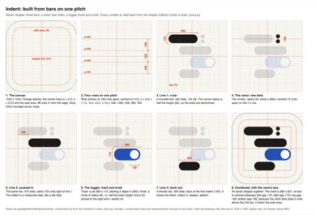</p>

Reading the strip: panel 1 is the sheet with the safe area; 2 the four rows on one <span title="A memo that proposes one idea to the Investors as the product. Only a B or better becomes one.">pitch</span>; 3 to 7 each element alone (the rest ghosted) with its measurements; 8 everything together with the mark's box.

### 7.3 Option 2, Prompt

**The idea.** The three chevrons `>>>` of Python's interactive prompt, followed by a waiting block cursor.

**The exact function** (`prompt(app)`):

```python
def prompt(app):
    defs = ""
    if app == "light":      # A Paper: ink chevrons on paper, the ink-blue block cursor
        bg, bg_stops, chev, caret = A_L["bg.canvas"], (A_L["bg.canvas"],), A_L["text.primary"], A_L["accent"]
    elif app == "dark":     # B Studio: gradient chevrons on the night surface, a pale cursor
        defs = lin_grad("g", B_D["bg.raised"], B_D["bg.canvas"], "0", "0", "0", "1") + \
               lin_grad("s", B_D["accent"], B_D["accent.2"], "0", "0", "1", "0")
        bg, bg_stops, chev, caret = "url(#g)", (B_D["bg.raised"], B_D["bg.canvas"]), "url(#s)", B_D["text.primary"]
    else:
        bg, bg_stops, chev, caret = T_BG, (T_BG,), T_HI, T_MID
    sw, hh, cw, pitch = 68, 128, 124, 186        # stroke, half height, chevron width, pitch
    blk_w, space = 132, 96                       # block cursor width, the space after the prompt
    width = 2 * pitch + cw + space + blk_w
    x0, yc = 512 - width / 2 + sw / 4, 512
    els = []
    for i in range(3):
        x = x0 + i * pitch
        q = [(x, yc - hh), (x + cw, yc), (x, yc + hh)]
        fq = (B_D["accent"] if i == 0 else B_D["accent.2"]) if app == "dark" else None
        els.append(stroke_path(q, sw, chev, fill_for_qa=fq))
    # A block cursor (not a bar): a bar after chevrons reads as "skip to end".
    els.append(rect(x0 + 2 * pitch + cw + space, yc - hh - sw / 2, blk_w, 2 * hh + sw, 16, caret))
    pairs = [("chevron vs bg " + c, (B_D["accent"] if app == "dark" else chev), c) for c in bg_stops]
    if app == "dark":
        pairs += [("chevron end vs bg " + c, B_D["accent.2"], c) for c in bg_stops]
    pairs += [("caret vs bg " + c, caret, c) for c in bg_stops]
    return {"bg": bg, "defs": defs, "bg_fill": bg_stops[0], "els": els, "pairs": pairs}
```

**The math, step by step.**

1. **Constants.** `sw = 68` (pen width), `hh = 128` (half the chevron's height), `cw = 124` (its width), `pitch = 186` (distance between chevrons), `blk_w = 132` (cursor width), `space = 96` (gap before the cursor).
2. **One chevron** is a line through three points: top `(x, 512 - 128)`, tip `(x + 124, 512)`, bottom `(x, 512 + 128)`. Each arm rises 128 over a run of 124, so the arms are about 46 degrees from horizontal (`atan(128/124)`), close to a square corner. The loop `for i in range(3)` draws it at x, x + 186, x + 372. The pitch (186) is a little less than width + pen (124 + 68 = 192), so the boxes around neighbouring chevrons overlap by 6 units, but the shapes nest without touching, like the real prompt.
3. **The cursor** is a rectangle 132 wide and `2 x 128 + 68 = 324` tall: the chevron's height plus one pen width, so its top and bottom line up with the chevrons' outer edges. Corner radius 16. It starts `96` after the last chevron's tip. A thin bar read as a media "skip to end" button in an earlier draft, so it is a block.
4. **Centring.** The row's width is `2 x 186 + 124 + 96 + 132 = 724`. It starts at `512 - 724 / 2`, and then `sw / 4 = 17` is added. Why: the round pen sticks out half a pen width (34) beyond the first chevron's x on the left, while the cursor has no such overhang on the right. Shifting by half of that overhang (17) makes the margins equal: 133 on the left, 133 on the right. The mark is 758 wide and 324 tall.

**Colour.** Light: chevrons `text.primary`, cursor `accent`, plain `bg.canvas`. Dark: the background is a top-to-bottom blend from `bg.raised` to `bg.canvas`; each chevron is painted with a violet-to-coral blend (`accent` to `accent.2`) across its own box; the cursor is `text.primary`. Tinted: chevrons white, cursor mid grey.

<p class="guide-shots">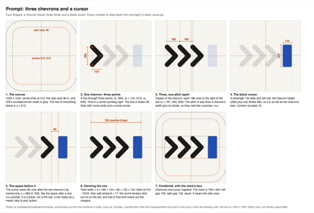</p>

### 7.4 Option 3, Trace

**The idea.** One curve, a loop drawn by a formula, with a dot for "now". The icon is itself a plot made by a script, which is what pywidget lets you do.

**The exact function** (`trace(app)`):

```python
# ------------------------------------------------------------ direction 3: Trace
# One parametric curve, x = cos 3t, y = sin 2t (a 3:2 Lissajous figure), and a
# dot where "now" is on it. Says: your code draws what the widget shows. The
# icon is itself a plot made by a script, which is the product in one picture.
def trace(app):
    defs = ""
    if app == "light":      # A Paper: an ink-blue curve on paper, an ink dot
        bg, st, d, stops = A_L["bg.canvas"], A_L["accent"], A_L["text.primary"], (A_L["accent"],)
    elif app == "dark":     # B Studio: the violet-to-coral curve on night, a pale dot
        defs = lin_grad("s", B_D["accent"], B_D["accent.2"], "0", "0", "1", "1")
        bg, st, d, stops = B_D["bg.canvas"], "url(#s)", B_D["text.primary"], (B_D["accent"], B_D["accent.2"])
    else:
        bg, st, d, stops = T_BG, T_MID, T_HI, (T_MID,)
    A, N = 292, 720
    pts = [(512 + A * math.cos(3 * t), 512 + A * math.sin(2 * t))
           for t in (2 * math.pi * k / N for k in range(N))]
    t0 = 2 * math.pi * 0.07                      # "now" marker, on the upper right lobe
    els = [stroke_path(pts, 60, st, closed=True, fill_for_qa=stops[0]),
           dot(512 + A * math.cos(3 * t0), 512 + A * math.sin(2 * t0), 64, d)]
    pairs = [("trace " + c, c, bg) for c in stops] + [("now dot", d, bg)]
    return {"bg": bg, "defs": defs, "bg_fill": bg, "els": els, "pairs": pairs}


DIRS = {"indent": indent, "prompt": prompt, "trace": trace}
```

**The math, step by step.**

1. **Two waves.** A *parameter* t is a dial that turns once around from 0 to 2 pi (0 to 360 degrees). Two formulas read the dial. `x = 512 + A cos(3t)`: the cosine is a wave that swings between -1 and +1, and the 3 makes it swing three times while t goes round once. `y = 512 + A sin(2t)`: the sine is the same wave shifted by a quarter swing, and the 2 makes it swing twice. A = 292 is how far the swing goes, so both x and y range from 512 - 292 = 220 to 512 + 292 = 804. Running the two together moves a pen; the path is the shape. A curve built this way, from two waves of different speeds, is called a Lissajous figure, and this one is 3 to 2.
2. **Points.** The code does not draw the formula directly; it computes `N = 720` points, one every `360 / 720 = 0.5` degrees (`t = 2 pi k / 720` for k = 0 to 719) and joins them with straight segments in `stroke_path(..., closed=True)`. Segments half a degree long are shorter than the pen is wide, so the line looks smooth.
3. **The pen** is 60 units wide, round ends and joins, which is why the box grows to 190 to 834 on each side (220 - 30 and 804 + 30).
4. **The dot.** `t0 = 2 pi x 0.07` is 7 per cent of a turn, 25.2 degrees. Putting it through the same two formulas gives the dot's centre at x = 512 + 292 cos(75.6 degrees) = 585 and y = 512 + 292 sin(50.4 degrees) = 737. The dot has radius 64, so it is wider than the 60 pen and reads as a bead on the line. A note for the record: the code comment says "upper right lobe", but y grows downward, so 737 is below the centre. The dot is on the right and *lower* part of the loop. The comment is wrong, the code is what is drawn.
5. **Fit.** The mark is 644 by 644, with a 190 margin on every side, the loosest fit of the three.

**Colour.** Light: curve `accent`, dot `text.primary`. Dark: the curve is painted with a corner-to-corner blend from violet (`accent`) to coral (`accent.2`) across its box, the dot is `text.primary`. Tinted: curve mid grey, dot white.

<p class="guide-shots">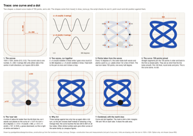</p>

### 7.5 The worker portraits (`tools/portrait.py`)

Each portrait on the company site is a silhouette of one closed mathematical curve. The worker's lowercase first name is the *seed* of a random-number generator (Python's `random.Random`), so the same name always gives the same picture, and the generator picks one of five curve families and its numbers. Each family has its own formula:

- **Hypotrochoid** (a spirograph curve): a point on a circle rolling inside a bigger one, `x = (k-1) cos t + d cos((k-1) t)`, `y = (k-1) sin t - d sin((k-1) t)`. k is the number of lobes, d how far the point sits from the rolling circle's middle.
- **Epitrochoid**: the same, with the circle rolling outside, using k+1.
- **Rose**: a flower, `r = 1 + 2a |cos(k t / 2)|^s - a`, where r is the distance from the middle at angle t, k counts petals, and the power s softens the tips.
- **Superformula** (Gielis, 2003): `r = ( |cos(m t / 4)|^n2 + |sin(m t / 4)|^n3 )^(-1/n1)`. m sets the number of corners; n1, n2, n3 set how round or pointed they are.
- **Lissajous**: `x = sin(a t + d)`, `y = sin(b t)`, two waves of different speed, as in Trace.

The curve becomes a silhouette in `outline()`. For the rose and superformula the curve is already a closed shape and its distance from the middle at each angle is used. The thin curves (the two trochoids and the Lissajous) are fattened: for each angle the code takes the farthest curve point nearby, then everything is scaled so the farthest is 1, smoothed with a three-point average, and drawn as a polygon of 180 points. Hue (0 to 359 degrees) and saturation (48 to 70 per cent) also come from the seed, with fixed lightness 44 per cent on a white tile. The code can measure how different two portraits are (`distance()`) and re-seed one that looks too like an earlier one (`assign_variants()`), so a shipped portrait may be a later variant of its name. The picture shows variant 0 of one name per family; for example Ines's portrait file contains exactly this variant-0 outline, while others on the site can differ for that reason. The motion in the animated copies is SVG animation chosen by temperament and mood, not drawn pictures.

<p class="guide-shots">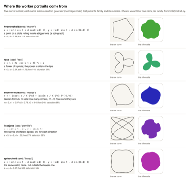</p>

### 7.6 Other pictures drawn by code

Read from each script's own header on 29 October 2026; I did not trace every line of these as I did the icons.

- **The design mockups and the app drawings in section 6** (`pywidget/docs/design/mockups/draw.py`, `.../states/draw_states.py` and its siblings). They write HTML, CSS and SVG from `design/tokens.json`, using Mac system fonts, and Chromium paints them. Widget glyphs are stand-in SVG paths, wallpapers are flat colours. They are drawings, not screenshots.
- **The extra editor themes** (`.../themes-pro/themes_pro.py`). Colours are solved by a search, not chosen by eye. OKLCH is a colour description with a number for perceived lightness (L), one for colourfulness (C) and one for hue. For each colour, the code fixes C and hue and finds the lightness that just reaches the required contrast against its backgrounds, by bisection: try the middle of the range, keep the half that works, repeat 50 times (`_solve()`).
- **Pitch mockups** (`tools/mockup.py`): SVG shapes from coordinates in the file.
- **The real app screens in section 2** are not drawn: they are screenshots of the running app, taken by a UI test.

Everything above runs offline and calls no model. To rebuild the icon strips: `python3 pywidget/docs/design/icon/draw_construction.py`.

## 8. Lock Screen widgets

Lock Screen widgets are not a separate feature. They are three more **sizes** of the same widget, drawn by the same engine. This section is the page the Investors were offered on issue #41 and accepted ("Yes please!"). It repeats the explanation already given there and adds a picture of every premade widget in every Lock Screen size it offers.

### 8.1 What they are (Apple's part)

Since iOS 16 the iPhone Lock Screen can hold small widgets in two places: one line of text above the clock, and a row of up to four slots below it. Apple names the sizes:

- **Inline**: one line of text, optionally with a small symbol, above the clock.
- **Circular**: a small circle below the clock, good for a gauge, a ring or a number.
- **Rectangular**: a wider slot below the clock, two or three short lines or a tiny chart.

Apple draws them **without colour**. The system turns the widget into shades of one tint that match the clock, so a design has to read as a silhouette. With Always-On they are dimmed further. iPad Lock Screens and StandBy (a charging iPhone on its side) use the same sizes.

### 8.2 How pywidget does it (our part)

- A person's Python script says which sizes it supports and, for each size, returns a description of what to show: the same "view tree" as for Home Screen widgets. One script can show a full card on the Home Screen and a single ring on the Lock Screen.
- The Swift renderer draws Lock Screen sizes exactly as it draws Home Screen ones. Apple supplies the monochrome look; the renderer adds Apple's standard Lock Screen pieces, such as the soft circle or pill background and gauge styles made for that space.
- Freshness is the same as on the Home Screen. Python runs in the app (when it is open, in background refresh, or from a Shortcuts automation), saves the result, and the Lock Screen widget redraws it. Times and countdowns tick by themselves without Python running.
- To add one, the person long-presses the Lock Screen, taps Customize, taps the widget row, and picks pywidget. This is Apple's standard flow.

### 8.3 Limits worth knowing

- No colour and very little room: one or two short facts at most. Photos turn into muddy silhouettes, so designs use text, symbols and simple shapes.
- Not interactive in version 1. Tapping opens the app. Buttons are planned for 1.1.
- iOS rations refreshes, as on the Home Screen: every 15 to 60 minutes at best, so a widget shows its last result and when it was made, not live data (section 4.1). Clocks and timers are the exception.
- Nobody has yet seen them on a real iPhone. Device testing waits on the signing request (issue #100).

### 8.4 All twelve premade widgets

All twelve premade widgets offer at least one Lock Screen size (the `FAMILIES` line in each `pywidget/widgets/premade/*.py`). A cell says "not offered" where that premade does not list the size. There are 24 pictures.

**What these pictures are (Commandment 33).** Each is a **Simulator render**: the app's own SwiftUI renderer, the one the widget extension uses, run in a test on the iPhone Simulator and saved as a PNG. They are not screenshots of a Lock Screen, and not photos of a phone. What is stand-in: the grey background (real Lock Screens show the wallpaper), the sizes (72 by 72 points, 160 by 72, 210 by 20; real sizes differ by iPhone model), and the data, which is each premade's saved example from `pywidget/tests/widgets/fixtures/premade-trees/` with a fixed clock of 31 October 2026, 09:41. The render uses the "vibrant" mode, which is how Apple tints Lock Screen widgets, shown here in white on grey because the real tint comes from the wallpaper. Countdown and Day progress timers read the Mac's clock, not the fixed one, so their time text can differ from run to run. Each picture is saved at twice the size.

The code that made them is the test `testLockScreenGuideRenders` in `pywidget/ios/Tests/PremadeSnapshotTests.swift`. It calls no image-making AI. To remake them: `tools/xc.sh -project PyWidget.xcodeproj -scheme PyWidget -destination "platform=iOS Simulator,name=iPhone 17e" test -only-testing:PyWidgetTests/PremadeSnapshotTests/testLockScreenGuideRenders`, run in `pywidget/ios/`. The pictures are in `pywidget/app-guide-shots/lockscreen/`.


<div class="tbl" role="region" tabindex="0" aria-label="Table 5: 8.4 All twelve premade widgets, scrolls sideways" style="--tw:502px" markdown="1">

| Premade | Circular | Rectangular | Inline |
|---|---|---|---|
| Altitude |  |  | not offered |
| World clocks | not offered |  |  |
| Countdown |  |  |  |
| Distance to a saved place | not offered |  |  |
| GitHub repository | not offered |  | not offered |
| Habit tracker |  | not offered | not offered |
| Day progress |  |  |  |
| Quote of the day | not offered |  | not offered |
| Shortcuts launcher |  | not offered | not offered |
| Steps and floors |  |  |  |
| Storage |  |  | not offered |
| Sunrise and sunset |  |  |  |

</div>


## Open questions

None open on 28 October 2026. The four questions raised in review are answered in the text: the editor on the main screen (section 2.3), the Pro and Gallery words (section 2.6), the licence row (section 2.7), and the source of the refresh figures (section 4).


<style>.guide-shots{display:flex;gap:.5rem;flex-wrap:wrap}.guide-shots img{max-width:calc(50% - .25rem);height:auto;border:1px solid var(--line);border-radius:12px}</style>


</div>
